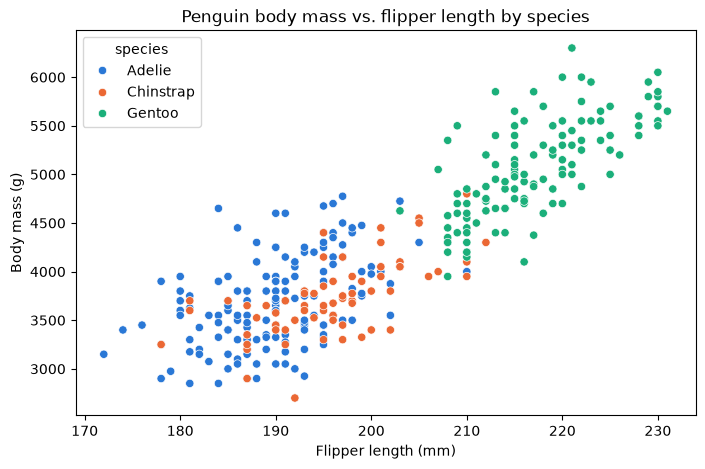
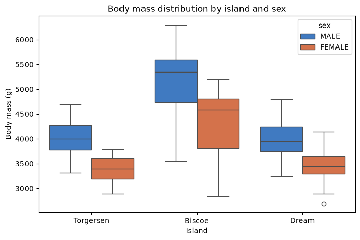

# Day 1 lab: Activity 1 — Readiness check

<p class="lead">
A short diagnostic that checks your tools and your starting point: run a small exploratory analysis of the Palmer Penguins data in Jupyter, build two quick views of the Sample – Superstore data in Tableau, answer five questions and submit one combined PDF.
</p>

*Adapted from the DATA 300 syllabus, Activity 1 (Self-Assessment and Readiness Check), for local Jupyter without internet access.*

| | |
|---|---|
| **Graded** | Yes: **4%** of the course grade |
| **Outcomes** | CLO 1, 2, 3 and 4 |
| **Tools** | JupyterLab (Anaconda) and Tableau Desktop |
| **You submit** | One PDF, `YourLastName_DATA300_Week1_Readiness.pdf`, on **GAP (Moodle)** |
| **Deadline** | As announced by your facilitator (see the [schedule](schedule.md)) |

---

## What you will do

| Part | Tool | You produce |
|---|---|---|
| **A. Jupyter** | This notebook | Summary tables, two charts, answers to questions 1–3, and a PDF of the notebook |
| **B. Tableau** | Tableau Desktop | Two worksheets, answers to questions 4–5, and a PDF of the workbook |
| **C. Submission** | A word processor and a PDF tool | Your answers as a PDF, then all three PDFs combined into one file |

You do **not** need to write code from scratch: the code below works as given. Your job is to run it, read the output and answer the questions.

### Before you start

1. Keep this notebook in the course folder, next to the `data` folder.
2. Save your own copy under the name the course uses: **File → Save Notebook As…** and type `YourLastName_Data300_Self_Check.ipynb` (with your real last name). Work in that copy.

---

## Part A: Exploratory analysis in Jupyter

The **Palmer Penguins** data records measurements of adult penguins of three species (Adelie, Chinstrap and Gentoo) on three islands near Palmer Station, Antarctica. One row is **one penguin**.

### A1. Import the libraries

Anaconda already includes these, so there is nothing to install. Run the cell.


```python
import matplotlib.pyplot as plt
import pandas as pd
import seaborn as sns

print("Libraries loaded: pandas", pd.__version__, "| seaborn", sns.__version__)
```

    Libraries loaded: pandas 2.2.3 | seaborn 0.13.2


### A2. Load the data

The file is in the `data` folder, so it loads without internet.


```python
df = pd.read_csv("data/penguins.csv")
print("Rows and columns:", df.shape)
```

    Rows and columns: (344, 7)


### A3. First rows and summary statistics

`head()` shows the first five penguins. `describe()` summarises every numeric column. Read the `count` row: a count lower than the number of rows means some values are **missing** (not recorded).


```python
print("--- First 5 rows of the dataset ---")
display(df.head())

print("\n--- Summary statistics ---")
display(df.describe())
```

    --- First 5 rows of the dataset ---


<div>
<style scoped>
    .dataframe tbody tr th:only-of-type {
        vertical-align: middle;
    }

    .dataframe tbody tr th {
        vertical-align: top;
    }

    .dataframe thead th {
        text-align: right;
    }
</style>
<table border="1" class="dataframe">
  <thead>
    <tr style="text-align: right;">
      <th></th>
      <th>species</th>
      <th>island</th>
      <th>bill_length_mm</th>
      <th>bill_depth_mm</th>
      <th>flipper_length_mm</th>
      <th>body_mass_g</th>
      <th>sex</th>
    </tr>
  </thead>
  <tbody>
    <tr>
      <th>0</th>
      <td>Adelie</td>
      <td>Torgersen</td>
      <td>39.1</td>
      <td>18.7</td>
      <td>181.0</td>
      <td>3750.0</td>
      <td>MALE</td>
    </tr>
    <tr>
      <th>1</th>
      <td>Adelie</td>
      <td>Torgersen</td>
      <td>39.5</td>
      <td>17.4</td>
      <td>186.0</td>
      <td>3800.0</td>
      <td>FEMALE</td>
    </tr>
    <tr>
      <th>2</th>
      <td>Adelie</td>
      <td>Torgersen</td>
      <td>40.3</td>
      <td>18.0</td>
      <td>195.0</td>
      <td>3250.0</td>
      <td>FEMALE</td>
    </tr>
    <tr>
      <th>3</th>
      <td>Adelie</td>
      <td>Torgersen</td>
      <td>NaN</td>
      <td>NaN</td>
      <td>NaN</td>
      <td>NaN</td>
      <td>NaN</td>
    </tr>
    <tr>
      <th>4</th>
      <td>Adelie</td>
      <td>Torgersen</td>
      <td>36.7</td>
      <td>19.3</td>
      <td>193.0</td>
      <td>3450.0</td>
      <td>FEMALE</td>
    </tr>
  </tbody>
</table>
</div>


    
    --- Summary statistics ---


<div>
<style scoped>
    .dataframe tbody tr th:only-of-type {
        vertical-align: middle;
    }

    .dataframe tbody tr th {
        vertical-align: top;
    }

    .dataframe thead th {
        text-align: right;
    }
</style>
<table border="1" class="dataframe">
  <thead>
    <tr style="text-align: right;">
      <th></th>
      <th>bill_length_mm</th>
      <th>bill_depth_mm</th>
      <th>flipper_length_mm</th>
      <th>body_mass_g</th>
    </tr>
  </thead>
  <tbody>
    <tr>
      <th>count</th>
      <td>342.000000</td>
      <td>342.000000</td>
      <td>342.000000</td>
      <td>342.000000</td>
    </tr>
    <tr>
      <th>mean</th>
      <td>43.921930</td>
      <td>17.151170</td>
      <td>200.915205</td>
      <td>4201.754386</td>
    </tr>
    <tr>
      <th>std</th>
      <td>5.459584</td>
      <td>1.974793</td>
      <td>14.061714</td>
      <td>801.954536</td>
    </tr>
    <tr>
      <th>min</th>
      <td>32.100000</td>
      <td>13.100000</td>
      <td>172.000000</td>
      <td>2700.000000</td>
    </tr>
    <tr>
      <th>25%</th>
      <td>39.225000</td>
      <td>15.600000</td>
      <td>190.000000</td>
      <td>3550.000000</td>
    </tr>
    <tr>
      <th>50%</th>
      <td>44.450000</td>
      <td>17.300000</td>
      <td>197.000000</td>
      <td>4050.000000</td>
    </tr>
    <tr>
      <th>75%</th>
      <td>48.500000</td>
      <td>18.700000</td>
      <td>213.000000</td>
      <td>4750.000000</td>
    </tr>
    <tr>
      <th>max</th>
      <td>59.600000</td>
      <td>21.500000</td>
      <td>231.000000</td>
      <td>6300.000000</td>
    </tr>
  </tbody>
</table>
</div>


### A4. Chart 1: flipper length against body mass, by species

A **scatter plot** with one dot per penguin. Colour shows the species.


```python
species_colours = {"Adelie": "#2a78d6", "Chinstrap": "#eb6834", "Gentoo": "#1baf7a"}

plt.figure(figsize=(8, 5))
sns.scatterplot(
    data=df,
    x="flipper_length_mm",
    y="body_mass_g",
    hue="species",
    palette=species_colours,
)
plt.title("Penguin body mass vs. flipper length by species")
plt.xlabel("Flipper length (mm)")
plt.ylabel("Body mass (g)")
plt.show()
```


    

    


### A5. Chart 2: body mass by island and sex

A **box plot** shows how values are spread within each group: the box covers the middle half of the penguins, the line inside it is the median, and the whiskers and dots show the rest.


```python
sex_colours = {"MALE": "#2a78d6", "FEMALE": "#eb6834"}

plt.figure(figsize=(8, 5))
sns.boxplot(
    data=df,
    x="island",
    y="body_mass_g",
    hue="sex",
    palette=sex_colours,
)
plt.title("Body mass distribution by island and sex")
plt.xlabel("Island")
plt.ylabel("Body mass (g)")
plt.show()
```


    

    


### A6. Answer questions 1–3

Use the outputs above to answer. Double-click the cell below, replace each *Your answer* with one or two sentences, then press **Shift + Enter**. Copy the same answers into your answers document in Part C.

| # | Topic | Question |
|---|---|---|
| **1** | Descriptive statistics | In the summary statistics table, what is the **mean body mass** (`body_mass_g`) of the penguins, in grams? |
| **2** | Relationship between two variables | In Chart 1, what happens to body mass as flipper length increases? Describe the general pattern. |
| **3** | Comparing groups | In Chart 1, which species (Adelie, Chinstrap or Gentoo) forms the cluster with the **highest** body mass? |

> **My answers to questions 1–3**
>
> **1. Mean body mass:** *Your answer*
>
> **2. Pattern between flipper length and body mass:** *Your answer*
>
> **3. Species with the heaviest cluster:** *Your answer*

### A7. Export this notebook to PDF

1. Choose **Kernel → Restart Kernel and Run All Cells**. Check that both tables, both charts and your answers are visible.
2. Choose **File → Print** (or Ctrl + P / Cmd + P).
3. In the print window, set the destination to **Save as PDF**. Under *More settings*, tick **Background graphics** so the chart colours are kept.
4. Save the file as **`Data300_Self_Check_Results_LastName.pdf`**, with your last name. This is your **Jupyter results PDF**.

> **If the PDF looks wrong**
>
> Charts missing usually means the notebook was not run before printing: run all cells and print again. Very wide tables may be cut at the page edge; that is acceptable here.

---

## Part B: Tableau readiness

Tableau is a widely used business intelligence (BI) tool. These steps are done in **Tableau Desktop**, not in this notebook. Tick each step as you go.

### B1. Get and activate Tableau

1. Your facilitator will tell you whether Tableau is already installed on the lab PCs.
2. On your own laptop: request a free **student licence** from Tableau's academic programme for students, using your university email address. You may need to confirm you are a student (for example with your student ID). The licence key arrives by email.
3. Download **Tableau Desktop**, install it, and activate it with the key.

> **No licence yet?**
>
> Verification can take a few days. Tell your facilitator: you can use **Tableau Public Desktop** for practice, or a lab PC, and complete Part B there.

### B2. Open the built-in data

1. Start Tableau Desktop.
2. On the start page, under **Saved Data Sources**, click **Sample – Superstore**. It contains made-up sales data for a retail company. A blank worksheet, *Sheet 1*, opens.

### B3. Worksheet 1: Sales by Category

1. In the **Data** pane on the left, drag **Category** onto the **Rows** shelf.
2. Drag **Sales** onto the **Columns** shelf. Tableau draws a horizontal bar chart: one bar per category, its length the total sales.
3. Optional: click **Sort Descending** on the toolbar so the longest bar is on top.
4. Double-click the sheet tab and rename it *Sales by Category*.

### B4. Worksheet 2: Profit map

1. Click the **New Worksheet** icon at the bottom of the window (the tab with a plus sign).
2. In the Data pane, double-click **State/Province** (in older versions of Tableau it is called **State**). Tableau draws a map with a dot for each state.
3. Drag **Profit** onto **Color** on the **Marks** card. States are now coloured by total profit: **blue** for a profit, **orange** for a loss.
4. Rename the sheet *Profit Map*.

### B5. Answer questions 4–5

Write these in your answers document (Part C).

| # | Question |
|---|---|
| **4** | From worksheet 1 (Sales by Category), which **product category** has the highest total sales? |
| **5** | From worksheet 2 (Profit Map), name **at least one US state** that is making a loss (coloured orange). |

### B6. Save the Tableau output as PDF

1. In Tableau, choose **File → Print to PDF**.
2. Select **Entire Workbook** so both worksheets are included.
3. Click **OK** and save the file as **`Tableau_Results.pdf`**.

> **Using Tableau Public?**
>
> Tableau Public Desktop may not offer *Print to PDF*. Take a screenshot of each worksheet, paste both into a document, and save that as `Tableau_Results.pdf`.

---

## Part C: Submission

### C1. Your answers as a PDF

1. In Word (or any word processor), write your answers to **all five questions**, numbered 1–5. Put your name and student ID at the top.
2. Save or export it as **`Answers.pdf`**.

### C2. Combine the three PDFs

Combine these three files, in this order, into **one** PDF:

1. `Answers.pdf`
2. Your Jupyter results PDF, `Data300_Self_Check_Results_LastName.pdf`
3. `Tableau_Results.pdf`

Use any PDF tool you have: for example **Preview** on macOS (drag the pages of one PDF into the sidebar of another), Adobe Acrobat, or a tool your facilitator recommends. Online PDF tools may be slow or blocked; ask your facilitator if you cannot combine the files.

Name the combined file **`YourLastName_DATA300_Week1_Readiness.pdf`**.

### C3. Upload

Upload the single combined PDF to the Activity 1 submission on **GAP (Moodle)**.

---

## Checklist before you upload

- [ ] The notebook was **restarted and run all** before printing; both tables and both charts appear in the Jupyter PDF.
- [ ] Questions 1–3 are answered in the notebook **and** in `Answers.pdf`.
- [ ] Both Tableau worksheets appear in `Tableau_Results.pdf`.
- [ ] Questions 4–5 are answered in `Answers.pdf`.
- [ ] The three PDFs are combined in the order Answers, Jupyter, Tableau.
- [ ] The file is named `YourLastName_DATA300_Week1_Readiness.pdf` and uploaded to GAP (Moodle).

## How it is marked

The activity is marked with the course's activity rubric: four criteria for **CLOs 1–4** (20 points each), plus **professional formatting** (10 points) and **clear academic writing** (10 points). In practice this means: complete, correct answers written in clear full sentences; all required outputs present and readable; and the files named and combined as asked.

> **Stuck?**
>
> Setup problems are exactly what this activity is meant to uncover. If a cell will not run or Tableau will not install, take a screenshot and tell your facilitator during the lab.
