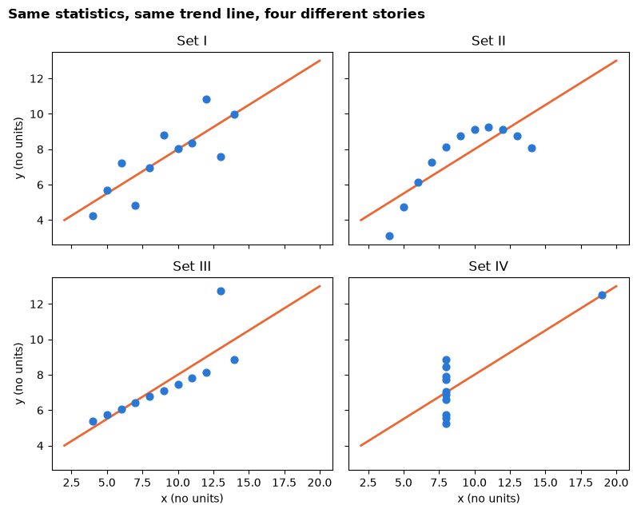
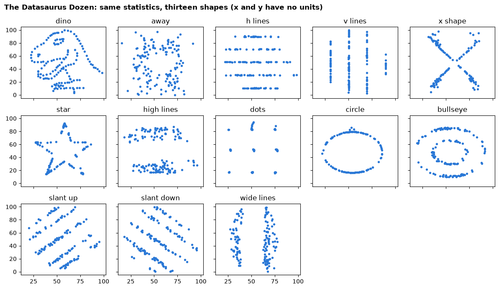
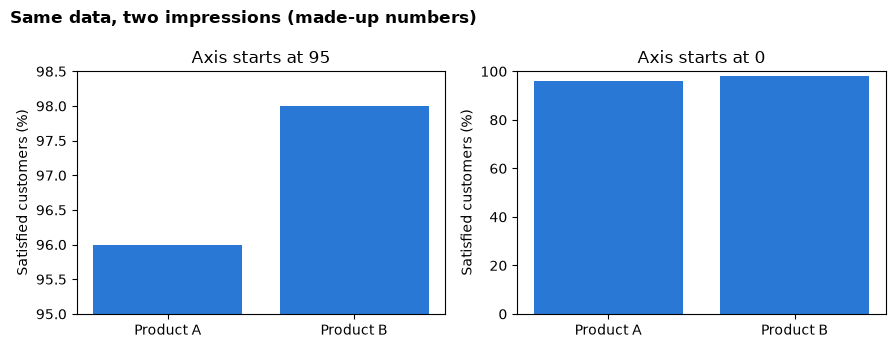

# Day 1 lecture: Data-driven decisions

<p class="lead">
Organisations make better decisions when they combine data, analysis and judgement. This lecture maps the course, explains the four kinds of analytics, sets out how an analysis is organised, and shows live why summary numbers alone can mislead.
</p>

Open this notebook in JupyterLab from the course folder and run each cell from top to bottom with **Shift + Enter**.

---

## What you will be able to do

1. Find your way around the course: its outcomes, graded work and schedule.
2. Explain why data-driven decisions tend to beat decisions made on instinct alone, and where judgement still matters.
3. Tell **descriptive**, **diagnostic**, **predictive** and **prescriptive** analytics apart, with a business example of each.
4. Follow the path from **question** to **data**, **analysis**, **validation** and **decision**, and turn a vague request into an answerable question.
5. Show with code why summary statistics are not enough, using Anscombe's quartet and the Datasaurus Dozen.
6. Name the most common ways numbers mislead.

**Reading:** Gordon (2023), *Business analytics*, Chapter 1 (how data and analytics can improve human decisions) and Chapter 4 (analysis fundamentals).

> **How to use the questions in this notebook**
>
> **Predict, then reveal** boxes ask you to guess before running the next cell. Write your guess down first: being wrong is how you learn what to check. **Check your understanding** boxes are short questions to answer in your own words, alone or with the person next to you.

| Part | Topic |
|---|---|
| 1 | The course map |
| 2 | Why data-driven decisions? |
| 3 | Four kinds of analytics |
| 4 | Analysis fundamentals: from question to decision |
| 5 | Statistics are not enough: Anscombe's quartet |
| 6 | The Datasaurus Dozen |
| 7 | A preview of how numbers mislead |

---

## Part 1: The course map

DATA 300 *Data Driven Decision Making* moves from **describing** what happened, to **predicting** what will happen, to **deciding** what to do. You will work in **Python with Jupyter**, **Tableau** and **Excel**.

### Course learning outcomes (CLOs)

Every graded item is tied to one or more of these outcomes.

| CLO | By the end of the course you can… |
|---|---|
| **1** | Describe the principles of descriptive, predictive and prescriptive analytics to solve business data challenges |
| **2** | Design and use data visualisation and modelling tools to communicate user-centred analytics for strategic decisions |
| **3** | Apply computational problem-solving to data and text mining, finding relationships in structured and unstructured data |
| **4** | Build predictive models with time-series forecasting, linear regression and spreadsheet simulation |
| **5** | Evaluate business intelligence tools in a full case study and write managerial reports that consider ethical and societal context |

### Graded work

| Item | Weight |
|---|---|
| Activity 1: self-assessment and readiness check (**this afternoon**) | 4% |
| Applied Labs 1–7 | 7 × 4% = 28% |
| Assignment 1: data visualisation and descriptive analytics report | 8% |
| SM Activity 1 | 3% |
| Midterm exam | 15% |
| Assignment 2: predictive data mining report | 7% |
| Assignment 3: spreadsheet simulation and decision model | 7% |
| Assignment 4: final comprehensive assignment (capstone) | 25% |
| SM Activity 2: reflection | 3% |

All work is submitted as a PDF on **GAP (Moodle)**.

### How the days work

Mornings are theory, like this lecture. Most afternoons end with a **lab**, where you complete a graded item in class. The [schedule](schedule.md) lists what happens each day and the deadlines; the [setup](setup.md) page explains the software. Today:

| When | What |
|---|---|
| Morning | This lecture |
| Early afternoon | [Python and Jupyter basics](D1_lecture_python_jupyter_basics.md) |
| Late afternoon | [Activity 1 lab](D1_lab_activity1_readiness.md): the readiness check in Jupyter and Tableau |

> **Check your understanding**
>
> Look at the graded-work table. Which single item is worth the most? Which outcome (CLO) do you expect today's work to support most?

---

## Part 2: Why data-driven decisions?

Every organisation decides things all the time: what to stock, whom to hire, which customers to target, how much to charge. Many of those decisions are still made on **gut feeling**, habit or the opinion of the most senior person in the room.

### The idea in one line

The course textbook's subtitle sums it up: good decisions **combine data, analysis and judgement**. Data on its own decides nothing. Analysis turns data into evidence. Judgement, from people who know the business, decides what the evidence means and what to do.

### Why instinct alone is risky

Human judgement is valuable, but it has predictable weak spots. Psychologists have named many of them:

| Weak spot | What happens | Example at work |
|---|---|---|
| **Confirmation bias** | We notice evidence that agrees with us and ignore the rest | A manager who believes a promotion worked only looks at the stores where sales rose |
| **Anchoring** | The first number we hear pulls our estimate towards it | Next year's budget is "last year plus 5%" whatever has changed |
| **Availability** | Vivid or recent events feel more common than they are | One angry customer email leads to a policy change for everyone |
| **Overconfidence** | We are more certain than our track record justifies | Sales forecasts that are always too optimistic |

Data and analysis do not remove these biases, but they give everyone something to **check against**. A decision based on evidence can also be explained, repeated and improved, because you can see what it rested on.

### Where judgement still matters

Analytics **supports** decisions; it does not make them. People still have to:

- choose the **question** worth answering;
- judge whether the data is **trustworthy** and relevant;
- weigh things the data does not capture: ethics, strategy, staff morale, reputation;
- take **responsibility** for the decision.

### Stories where data changed the outcome

| Story | What happened | The habit it teaches |
|---|---|---|
| **John Snow**, London, 1854 | Mapping cholera deaths showed them clustered around one water pump. Its handle was removed. | A simple, well-chosen picture can overturn what "everyone knows". |
| **Florence Nightingale**, 1850s | Her diagrams showed most soldiers died of preventable disease in hospitals, not of wounds. | Analysis only changes things when decision-makers understand it. |
| **Moneyball**, baseball, 2002 | A low-budget team found undervalued players by measuring on-base percentage. | Measuring the *right* thing can matter more than having the most money. |
| **Walmart**, hurricane, 2004 | Sales patterns before earlier storms guided what to stock before a new one. | Past patterns can guide everyday operational decisions. |
| **Google Flu Trends**, 2008–2015 | Estimating flu from searches worked for a while, then failed badly and was shut down. | More data is not automatically better data. Every result needs validation. |

The full stories are in [Why data analytics matters](../foundations/index.md).

> **Predict, then reveal**
>
> Four of these stories are successes; one is a failure. Before reading the last row, ask yourself: what could make a model that once worked stop working? Then read the last row.

> **Check your understanding**
>
> Think of one decision at a workplace or organisation you know that was made on gut feeling. What data could have informed it, and which of the four weak spots might have affected it?

---

## Part 3: Four kinds of analytics

Analytics answers four kinds of question. Each builds on the one before.

| Kind | Question it answers | Typical methods | Example |
|---|---|---|---|
| **Descriptive** | What happened? | Totals, averages, tables, charts, dashboards | Sales fell 8% last quarter |
| **Diagnostic** | Why did it happen? | Breakdowns by group, comparisons, correlation | The fall came almost entirely from one region after a competitor opened |
| **Predictive** | What is likely to happen next? | Forecasting, regression, classification | If nothing changes, that region will keep losing sales next quarter |
| **Prescriptive** | What should we do? | Simulation, optimisation, scenario comparison | Test a local loyalty offer in that region before changing national prices |

Many textbooks, including ours, group the first two together and speak of **descriptive, predictive and prescriptive** analytics. Diagnostic work is the bridge: it explains the description before anyone predicts or prescribes.

### Across the business

| Function | Descriptive | Predictive | Prescriptive |
|---|---|---|---|
| Retail | Sales by product last month | Demand next month | How much stock to order |
| Finance | Spending against budget | Cash position next quarter | Which costs to cut first |
| Marketing | Response rate of each campaign | Which customers are likely to respond | Whom to send the next offer to |
| Operations | Average delivery time | Late deliveries during the holiday peak | How many drivers to schedule |
| HR | Staff turnover by department | Who is at risk of leaving | Which retention programme to fund |

### Where each kind appears in this course

| Kind | Course topics |
|---|---|
| Descriptive and diagnostic | Data exploration, visualisation, dashboards, text mining (Days 1–4) |
| Predictive | Forecasting and regression (Days 5–6) |
| Prescriptive | Spreadsheet simulation and decision models (Day 7) |

### A small live example

The cell below loads a table of restaurant bills that you will meet properly this afternoon. Each row is one table's bill and the tip it left (in US dollars, from a real restaurant study). We use it only to see the first three kinds of question in code.


```python
import matplotlib.pyplot as plt
import numpy as np
import pandas as pd

tips = pd.read_csv("data/tips.csv")
tips["tip_percent"] = 100 * tips["tip"] / tips["total_bill"]

# Descriptive: what happened? Average tip on each day.
print("Descriptive: average tip (US dollars) by day")
print(tips.groupby("day")["tip"].mean().round(2))
```

    Descriptive: average tip (US dollars) by day
    day
    Fri     2.73
    Sat     2.99
    Sun     3.26
    Thur    2.77
    Name: tip, dtype: float64


> **Predict, then reveal**
>
> One day has the highest average tip. Is that because people are more **generous** that day, or because they spend **more**? Write your guess, then run the next cell, which looks at the average bill and the tip as a percentage of the bill.


```python
# Diagnostic: why? Compare the bill size and the tip as a share of the bill.
print("Diagnostic: average bill and tip percentage by day")
tips.groupby("day").agg(
    average_bill=("total_bill", "mean"),
    average_tip_percent=("tip_percent", "mean"),
).round(2)
```

    Diagnostic: average bill and tip percentage by day


<div>
<style scoped>
    .dataframe tbody tr th:only-of-type {
        vertical-align: middle;
    }

    .dataframe tbody tr th {
        vertical-align: top;
    }

    .dataframe thead th {
        text-align: right;
    }
</style>
<table border="1" class="dataframe">
  <thead>
    <tr style="text-align: right;">
      <th></th>
      <th>average_bill</th>
      <th>average_tip_percent</th>
    </tr>
    <tr>
      <th>day</th>
      <th></th>
      <th></th>
    </tr>
  </thead>
  <tbody>
    <tr>
      <th>Fri</th>
      <td>17.15</td>
      <td>16.99</td>
    </tr>
    <tr>
      <th>Sat</th>
      <td>20.44</td>
      <td>15.32</td>
    </tr>
    <tr>
      <th>Sun</th>
      <td>21.41</td>
      <td>16.69</td>
    </tr>
    <tr>
      <th>Thur</th>
      <td>17.68</td>
      <td>16.13</td>
    </tr>
  </tbody>
</table>
</div>


Compare the two columns in the output above. Where the average tip is high, look at whether the **bill** or the **percentage** is what differs. A difference in amounts can come from a difference in spending rather than in generosity: that is a diagnostic finding.

Now a prediction: the straight line that best fits tip against bill lets us estimate the tip on a new bill.


```python
# Predictive: what is likely? Fit a straight line of tip against bill.
slope, intercept = np.polyfit(tips["total_bill"], tips["tip"], 1)
new_bill = 40
print(f"Best-fit line: tip = {intercept:.2f} + {slope:.3f} x bill")
print(f"Predicted tip on a {new_bill}-dollar bill: {intercept + slope * new_bill:.2f} dollars")
```

    Best-fit line: tip = 0.92 + 0.105 x bill
    Predicted tip on a 40-dollar bill: 5.12 dollars


**Prescriptive** analytics would go one step further: compare **options** (for example, which evening to add a second server) against an **objective** (service quality, wages) under **constraints** (staff available), and recommend one. You will build that kind of model in Excel on Day 7.

> **Check your understanding**
>
> Which kind of analytics is each statement?
>
> 1. "Deliveries in the North got slower because the new carrier skips Saturday collections."
> 2. "We expect about 400 returns in December."
> 3. "Move the slow carrier's routes to the faster one for one month and measure the effect."
> 4. "We shipped 12,000 parcels in October."
> 5. "A customer who has not ordered for 90 days is likely to leave."

---

## Part 4: Analysis fundamentals — from question to decision

A useful analysis supports a **decision**. It follows the same path every time:

**Question → Data → Analysis → Validation → Decision**

| Stage | Ask | Keep as evidence |
|---|---|---|
| **1. Question** | Who must decide what, and by when? | The decision and a one-sentence question |
| **2. Data** | What does each row represent? What is missing? How must it be prepared? | The grain, units, scope, and a log of every change |
| **3. Analysis** | Which comparison or metric actually answers the question? | The metric definition, filters and calculation |
| **4. Validation** | Do totals reconcile? Can I explain odd values? Does a chart agree with the numbers? | Spot checks, counts and totals, edge cases |
| **5. Decision** | What action follows, and what is still uncertain? | A clear chart, the action, one caveat and a follow-up measure |

The course site describes the same path as [seven steps](../course/workflow.md), splitting out preparation and visualisation.

### Step 1 in detail: a question you can answer

A manager says: *"Sales feel uneven across our customer groups."* That is a feeling, not a question. A question you can answer with data names four things:

| Part | Ask yourself | Example |
|---|---|---|
| **Decision** | What will someone do differently? | Choose one customer segment to investigate next month |
| **Population** | Which records count? | All order lines in the sales table |
| **Period** | Which dates? | Orders placed in the last three years |
| **Measure** | What will we compare? | Total sales by customer segment |

> *"Which customer segment had the highest total sales over the last three years, so we can choose one segment to investigate next month?"*

### Step 2 in detail: what does one row mean?

A manager asks: *"How many orders did we have?"* The sales file has one row per **order line**, so an order with three products takes three rows. Counting rows counts **lines**, not orders. You must first know what one row represents (the table's **grain**), then count distinct order numbers. You will practise this in the afternoon.

### Step 4 in detail: validation

> **A plausible number is not a checked number**
>
> Before you report a result: do the parts add up to the total? Does a count match a simple manual check? Can you explain the largest and smallest values? Have you **looked** at the data in a chart, not only at summary numbers? Parts 5 and 6 show why that last check matters.

> **Check your understanding**
>
> A colleague asks: *"Is the new website working?"* Which of the four parts (decision, population, period, measure) are missing? Suggest one value for each.

---

## Part 5: Statistics are not enough — Anscombe's quartet

In 1973 the statistician **Francis Anscombe** made four small datasets to make one point. We build them in code, compute their summary statistics, and only then look at them.

The code stores all four datasets in one table. Each row is one point: which set it belongs to (`set`) and its `x` and `y` values.


```python
# Anscombe's quartet (1973): four small datasets, eleven points each.
x = [10, 8, 13, 9, 11, 14, 6, 4, 12, 7, 5]
anscombe = pd.concat([
    pd.DataFrame({"set": "I",   "x": x, "y": [8.04, 6.95, 7.58, 8.81, 8.33, 9.96, 7.24, 4.26, 10.84, 4.82, 5.68]}),
    pd.DataFrame({"set": "II",  "x": x, "y": [9.14, 8.14, 8.74, 8.77, 9.26, 8.10, 6.13, 3.10, 9.13, 7.26, 4.74]}),
    pd.DataFrame({"set": "III", "x": x, "y": [7.46, 6.77, 12.74, 7.11, 7.81, 8.84, 6.08, 5.39, 8.15, 6.42, 5.73]}),
    pd.DataFrame({"set": "IV",  "x": [8, 8, 8, 8, 8, 8, 8, 19, 8, 8, 8],
                  "y": [6.58, 5.76, 7.71, 8.84, 8.47, 7.04, 5.25, 12.50, 5.56, 7.91, 6.89]}),
], ignore_index=True)

print("Rows, columns:", anscombe.shape)
anscombe.head()
```

    Rows, columns: (44, 3)


<div>
<style scoped>
    .dataframe tbody tr th:only-of-type {
        vertical-align: middle;
    }

    .dataframe tbody tr th {
        vertical-align: top;
    }

    .dataframe thead th {
        text-align: right;
    }
</style>
<table border="1" class="dataframe">
  <thead>
    <tr style="text-align: right;">
      <th></th>
      <th>set</th>
      <th>x</th>
      <th>y</th>
    </tr>
  </thead>
  <tbody>
    <tr>
      <th>0</th>
      <td>I</td>
      <td>10</td>
      <td>8.04</td>
    </tr>
    <tr>
      <th>1</th>
      <td>I</td>
      <td>8</td>
      <td>6.95</td>
    </tr>
    <tr>
      <th>2</th>
      <td>I</td>
      <td>13</td>
      <td>7.58</td>
    </tr>
    <tr>
      <th>3</th>
      <td>I</td>
      <td>9</td>
      <td>8.81</td>
    </tr>
    <tr>
      <th>4</th>
      <td>I</td>
      <td>11</td>
      <td>8.33</td>
    </tr>
  </tbody>
</table>
</div>


Now the summary statistics for each set. `groupby("set")` splits the table into the four sets; `agg` computes several summaries for each one. The **correlation** measures how closely the points follow a straight line, from −1 to +1.


```python
summary = anscombe.groupby("set").agg(
    mean_x=("x", "mean"),
    mean_y=("y", "mean"),
    sd_x=("x", "std"),
    sd_y=("y", "std"),
)
summary["correlation"] = anscombe.groupby("set")[["x", "y"]].apply(lambda d: d["x"].corr(d["y"]))
summary.round(2)
```


<div>
<style scoped>
    .dataframe tbody tr th:only-of-type {
        vertical-align: middle;
    }

    .dataframe tbody tr th {
        vertical-align: top;
    }

    .dataframe thead th {
        text-align: right;
    }
</style>
<table border="1" class="dataframe">
  <thead>
    <tr style="text-align: right;">
      <th></th>
      <th>mean_x</th>
      <th>mean_y</th>
      <th>sd_x</th>
      <th>sd_y</th>
      <th>correlation</th>
    </tr>
    <tr>
      <th>set</th>
      <th></th>
      <th></th>
      <th></th>
      <th></th>
      <th></th>
    </tr>
  </thead>
  <tbody>
    <tr>
      <th>I</th>
      <td>9.0</td>
      <td>7.5</td>
      <td>3.32</td>
      <td>2.03</td>
      <td>0.82</td>
    </tr>
    <tr>
      <th>II</th>
      <td>9.0</td>
      <td>7.5</td>
      <td>3.32</td>
      <td>2.03</td>
      <td>0.82</td>
    </tr>
    <tr>
      <th>III</th>
      <td>9.0</td>
      <td>7.5</td>
      <td>3.32</td>
      <td>2.03</td>
      <td>0.82</td>
    </tr>
    <tr>
      <th>IV</th>
      <td>9.0</td>
      <td>7.5</td>
      <td>3.32</td>
      <td>2.03</td>
      <td>0.82</td>
    </tr>
  </tbody>
</table>
</div>


Finally, the straight line that best fits each set. `np.polyfit(x, y, 1)` returns its slope and intercept.


```python
for name, points in anscombe.groupby("set"):
    slope, intercept = np.polyfit(points["x"], points["y"], 1)
    print(f"Set {name:>3}: best-fit line  y = {intercept:.2f} + {slope:.3f} x")
```

    Set   I: best-fit line  y = 3.00 + 0.500 x
    Set  II: best-fit line  y = 3.00 + 0.500 x
    Set III: best-fit line  y = 3.00 + 0.500 x
    Set  IV: best-fit line  y = 3.00 + 0.500 x


> **Predict, then reveal**
>
> Read the outputs above. The four sets share their means, spreads, correlation and best-fit line. Sketch what you think a scatter plot of each set looks like. Will the four pictures be similar? Then run the next cell.


```python
fig, axes = plt.subplots(2, 2, figsize=(8, 6.5), sharex=True, sharey=True)
line_x = np.array([2, 20])
for ax, (name, points) in zip(axes.flat, anscombe.groupby("set")):
    slope, intercept = np.polyfit(points["x"], points["y"], 1)
    ax.plot(line_x, intercept + slope * line_x, color="#eb6834", linewidth=2)
    ax.scatter(points["x"], points["y"], s=40, color="#2a78d6", zorder=3)
    ax.set_title(f"Set {name}")
for ax in axes[1]:
    ax.set_xlabel("x (no units)")
for ax in axes[:, 0]:
    ax.set_ylabel("y (no units)")
fig.suptitle("Same statistics, same trend line, four different stories", x=0.01, ha="left", fontweight="bold")
fig.tight_layout()
plt.show()
```


    

    


| Set | What the picture shows | What the statistics hide |
|---|---|---|
| **I** | A loose, roughly straight-line relationship | Nothing: the summary describes it well |
| **II** | A smooth curve | The relationship is not a straight line |
| **III** | A perfect line except for one outlier | One unusual point drags the trend line |
| **IV** | Almost every point has the same x; one far point creates the "trend" | Remove that point and there is no trend to measure |

> **Remember**
>
> Summary statistics compress data, and compression throws information away. A chart shows you what was thrown away. Plot first, then summarise.

> **Check your understanding**
>
> In set IV, suppose the one point far to the right is a data-entry error and you remove it. What happens to the correlation? Why can you not even compute it?

---

## Part 6: The Datasaurus Dozen

In 2017 **Justin Matejka and George Fitzmaurice** pushed Anscombe's idea further. Starting from a dinosaur drawn with data points (originally by Alberto Cairo), they nudged the points step by step into twelve other shapes while keeping the summary statistics almost identical.

Their data is in the course folder, so it loads without internet.


```python
# The Datasaurus Dozen (Matejka and Fitzmaurice, 2017), from the open-source
# datasauRus package (MIT licence), bundled in the data folder.
dozen = pd.read_csv("data/datasaurus_dozen.csv")

print("Rows, columns:", dozen.shape)
print("Datasets:", dozen["dataset"].nunique())
dozen.head()
```

    Rows, columns: (1846, 3)
    Datasets: 13


<div>
<style scoped>
    .dataframe tbody tr th:only-of-type {
        vertical-align: middle;
    }

    .dataframe tbody tr th {
        vertical-align: top;
    }

    .dataframe thead th {
        text-align: right;
    }
</style>
<table border="1" class="dataframe">
  <thead>
    <tr style="text-align: right;">
      <th></th>
      <th>dataset</th>
      <th>x</th>
      <th>y</th>
    </tr>
  </thead>
  <tbody>
    <tr>
      <th>0</th>
      <td>dino</td>
      <td>55.3846</td>
      <td>97.1795</td>
    </tr>
    <tr>
      <th>1</th>
      <td>dino</td>
      <td>51.5385</td>
      <td>96.0256</td>
    </tr>
    <tr>
      <th>2</th>
      <td>dino</td>
      <td>46.1538</td>
      <td>94.4872</td>
    </tr>
    <tr>
      <th>3</th>
      <td>dino</td>
      <td>42.8205</td>
      <td>91.4103</td>
    </tr>
    <tr>
      <th>4</th>
      <td>dino</td>
      <td>40.7692</td>
      <td>88.3333</td>
    </tr>
  </tbody>
</table>
</div>


> **Predict, then reveal**
>
> The table has thirteen datasets. Their names (`dino`, `star`, `circle`, …) are a hint. First look at the statistics in the next cell. Would you have guessed the datasets had different shapes from these numbers alone?


```python
dozen_summary = dozen.groupby("dataset").agg(
    mean_x=("x", "mean"),
    mean_y=("y", "mean"),
    sd_x=("x", "std"),
    sd_y=("y", "std"),
)
dozen_summary["correlation"] = dozen.groupby("dataset")[["x", "y"]].apply(lambda d: d["x"].corr(d["y"]))
dozen_summary.round(2)
```


<div>
<style scoped>
    .dataframe tbody tr th:only-of-type {
        vertical-align: middle;
    }

    .dataframe tbody tr th {
        vertical-align: top;
    }

    .dataframe thead th {
        text-align: right;
    }
</style>
<table border="1" class="dataframe">
  <thead>
    <tr style="text-align: right;">
      <th></th>
      <th>mean_x</th>
      <th>mean_y</th>
      <th>sd_x</th>
      <th>sd_y</th>
      <th>correlation</th>
    </tr>
    <tr>
      <th>dataset</th>
      <th></th>
      <th></th>
      <th></th>
      <th></th>
      <th></th>
    </tr>
  </thead>
  <tbody>
    <tr>
      <th>away</th>
      <td>54.27</td>
      <td>47.83</td>
      <td>16.77</td>
      <td>26.94</td>
      <td>-0.06</td>
    </tr>
    <tr>
      <th>bullseye</th>
      <td>54.27</td>
      <td>47.83</td>
      <td>16.77</td>
      <td>26.94</td>
      <td>-0.07</td>
    </tr>
    <tr>
      <th>circle</th>
      <td>54.27</td>
      <td>47.84</td>
      <td>16.76</td>
      <td>26.93</td>
      <td>-0.07</td>
    </tr>
    <tr>
      <th>dino</th>
      <td>54.26</td>
      <td>47.83</td>
      <td>16.77</td>
      <td>26.94</td>
      <td>-0.06</td>
    </tr>
    <tr>
      <th>dots</th>
      <td>54.26</td>
      <td>47.84</td>
      <td>16.77</td>
      <td>26.93</td>
      <td>-0.06</td>
    </tr>
    <tr>
      <th>h_lines</th>
      <td>54.26</td>
      <td>47.83</td>
      <td>16.77</td>
      <td>26.94</td>
      <td>-0.06</td>
    </tr>
    <tr>
      <th>high_lines</th>
      <td>54.27</td>
      <td>47.84</td>
      <td>16.77</td>
      <td>26.94</td>
      <td>-0.07</td>
    </tr>
    <tr>
      <th>slant_down</th>
      <td>54.27</td>
      <td>47.84</td>
      <td>16.77</td>
      <td>26.94</td>
      <td>-0.07</td>
    </tr>
    <tr>
      <th>slant_up</th>
      <td>54.27</td>
      <td>47.83</td>
      <td>16.77</td>
      <td>26.94</td>
      <td>-0.07</td>
    </tr>
    <tr>
      <th>star</th>
      <td>54.27</td>
      <td>47.84</td>
      <td>16.77</td>
      <td>26.93</td>
      <td>-0.06</td>
    </tr>
    <tr>
      <th>v_lines</th>
      <td>54.27</td>
      <td>47.84</td>
      <td>16.77</td>
      <td>26.94</td>
      <td>-0.07</td>
    </tr>
    <tr>
      <th>wide_lines</th>
      <td>54.27</td>
      <td>47.83</td>
      <td>16.77</td>
      <td>26.94</td>
      <td>-0.07</td>
    </tr>
    <tr>
      <th>x_shape</th>
      <td>54.26</td>
      <td>47.84</td>
      <td>16.77</td>
      <td>26.93</td>
      <td>-0.07</td>
    </tr>
  </tbody>
</table>
</div>


Now draw one small scatter plot per dataset. Charts like this, one per group on the same axes, are called **small multiples**.


```python
names = dozen["dataset"].unique()
fig, axes = plt.subplots(3, 5, figsize=(12, 7), sharex=True, sharey=True)
for ax in axes.flat:
    ax.set_visible(False)
for ax, name in zip(axes.flat, names):
    points = dozen[dozen["dataset"] == name]
    ax.set_visible(True)
    ax.scatter(points["x"], points["y"], s=8, color="#2a78d6")
    ax.set_title(name.replace("_", " "))
fig.suptitle("The Datasaurus Dozen: same statistics, thirteen shapes (x and y have no units)",
             x=0.01, ha="left", fontweight="bold")
fig.tight_layout()
plt.show()
```


    

    


A report saying *"x and y are essentially unrelated, centred around the same values"* would be true for every panel, including the dinosaur.

> **At work**
>
> You will rarely meet a dinosaur in a sales report. You will meet the same problem in everyday forms: an average delivery time that hides a group of customers waiting weeks; one huge order that makes a quiet month look like growth; two stores with the same average sales but very different patterns. See [Statistics are not enough](../foundations/statistics-are-not-enough.md).

> **Check your understanding**
>
> Why are the thirteen panels drawn with the **same** axes? What could go wrong if each panel chose its own axis range?

---

## Part 7: A preview of how numbers mislead

Numbers feel objective, but the same data can tell very different stories depending on how it is summarised and drawn. Here is one trap, live. Both charts below show the **same two numbers**.

> **Predict, then reveal**
>
> Two products have satisfaction scores of 96% and 98%. Before running the cell, decide: is that a big difference or a small one? Then see how each chart makes you feel about it.


```python
products = ["Product A", "Product B"]
satisfaction = [96, 98]  # made-up percentages

fig, (left, right) = plt.subplots(1, 2, figsize=(9, 3.5))
left.bar(products, satisfaction, color="#2a78d6")
left.set_ylim(95, 98.5)
left.set_title("Axis starts at 95")
right.bar(products, satisfaction, color="#2a78d6")
right.set_ylim(0, 100)
right.set_title("Axis starts at 0")
for ax in (left, right):
    ax.set_ylabel("Satisfied customers (%)")
fig.suptitle("Same data, two impressions (made-up numbers)", x=0.01, ha="left", fontweight="bold")
fig.tight_layout()
plt.show()
```


    

    


We judge bars by their **length**, so bar charts should start at zero. On the left, Product B looks several times better; on the right you see two products that are almost the same.

The full list of traps is in [How statistics can mislead](../foundations/misleading-statistics.md). We return to each one later in the course.

| Trap | One-line warning | Where we meet it again |
|---|---|---|
| Correlation is not causation | Two things moving together may share a hidden cause | Day 2 (correlation), Day 6 (regression) |
| Simpson's paradox | A total can reverse the story of every part | Day 2 |
| Misleading axes | Where the axis starts changes the impression | Day 2 (visualisation) |
| Cherry-picked time windows | The chosen start and end dates can create any trend | Day 5 (forecasting) |
| Which average? | Mean and median can tell different stories | Day 2 (descriptive statistics) |
| Percentages without the base | "Up 200%" means little without the counts | Day 3 (KPIs) |
| Survivorship bias | The records you see may be only the survivors | Day 7 (case studies) |

> **A checklist for any number you are shown**
>
> 1. **Compared to what?**
> 2. **Who or what is included?**
> 3. **What is the denominator?**
> 4. **Could something else explain it?**
> 5. **How is it drawn?**

---

## Summary

- Good decisions combine **data, analysis and judgement**. Data gives everyone something to check instinct against; people still choose the question and own the decision.
- Analytics answers four kinds of question: what happened (**descriptive**), why (**diagnostic**), what next (**predictive**) and what to do (**prescriptive**).
- Every analysis runs **question → data → analysis → validation → decision**. A good question names a decision, population, period and measure.
- Different data can share identical summary statistics. **Always plot your data.**
- Numbers mislead through causation claims, mixed groups, axes, time windows, averages, missing bases and survivors.

---

## Closing quiz

Answer in your own words, alone, in two or three minutes per question. We discuss the answers before lunch.

1. Name the four kinds of analytics and give a one-line business example of the **predictive** kind.
2. Give one reason why a decision based only on a manager's instinct can go wrong, and one thing data cannot decide for you.
3. Rewrite *"How are our stores doing?"* as an analytical question that names a decision, population, period and measure.
4. Two datasets have the same mean, standard deviation and correlation. Can you conclude they look alike? What should you do?
5. In Anscombe's set III, what single feature of the data changes the best-fit line?
6. Why should a bar chart's value axis start at zero?
7. In the path question → data → analysis → validation → decision, what is the difference between **analysis** and **validation**?

---

## This afternoon

1. **Theory:** [Python and Jupyter basics](D1_lecture_python_jupyter_basics.md): notebooks, Python essentials, DataFrames, data types and what a row means.
2. **Lab:** [Activity 1, the readiness check](D1_lab_activity1_readiness.md) (4%), in Jupyter and Tableau.
