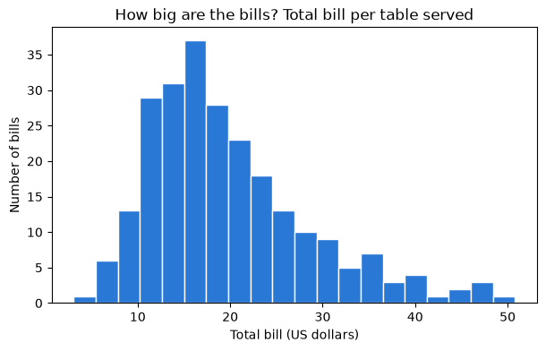
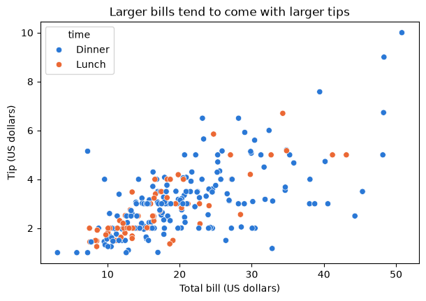

# Day 1 lecture: Python and Jupyter basics

<p class="lead">
Learn just enough Jupyter, Python and pandas to run every notebook in this course: cells and outputs, variables and lists, loading a table, selecting, filtering and grouping, the kind of data each column holds, what one row means, and a first chart.
</p>

Open this notebook in JupyterLab from the course folder and run each cell from top to bottom with **Shift + Enter**.

---

## What you will be able to do

1. Open, run, edit, restart and export a notebook in JupyterLab.
2. Use Python variables, numbers, text, lists and dictionaries, and call a function.
3. Load a CSV file into a pandas **DataFrame** and inspect it with `head`, `shape`, `dtypes` and `describe`.
4. Select columns, filter rows, group and count.
5. Name the **level of measurement** of a column and choose a sensible summary for it.
6. Say what one row of a table represents (its **grain**).
7. Draw a first chart with matplotlib and seaborn.

> **How the course uses code**
>
> Every notebook gives you **working code** with explanations. You **read** it, **run** it, then **change** a few lines. You will not be asked to write programs from scratch.

| Part | Topic |
|---|---|
| 1 | A tour of JupyterLab |
| 2 | Python essentials |
| 3 | DataFrames with pandas |
| 4 | Data types and levels of measurement |
| 5 | What does a row mean? |
| 6 | A first chart |

---

## Part 1: A tour of JupyterLab

**JupyterLab** is the program you use to open and run notebooks. You start it from **Anaconda Navigator** (click *Launch* under JupyterLab) or by typing `jupyter lab` in Anaconda Prompt (Windows) or Terminal (macOS). It opens in your web browser but runs on **your computer**, so it works without internet.

| Area | What it is for |
|---|---|
| **File browser** (left) | Open the course folder and double-click a notebook (`.ipynb`) |
| **Notebook** (centre) | A list of **cells**, run from top to bottom |
| **Toolbar** | Run, stop, restart, add cells, choose the cell type |
| **Kernel** (top right) | The Python process that runs your code. "Idle" means ready |

### Two kinds of cell

| Cell type | Contains | When you run it |
|---|---|---|
| **Markdown** | Formatted text, like this cell | It shows as formatted text |
| **Code** | Python | Python runs it and shows the result underneath |

### Keys worth learning today

| Key | Action |
|---|---|
| **Shift + Enter** | Run the cell and move to the next one |
| **Enter** | Start editing the selected cell |
| **Esc** | Stop editing (the cell stays selected) |
| **A** / **B** (not editing) | Add a cell above / below |
| **M** / **Y** (not editing) | Turn the cell into Markdown / Code |
| **D, D** (not editing) | Delete the cell |
| **Ctrl + S** (Cmd + S on macOS) | Save |

Run the next cell with **Shift + Enter**. The number in brackets on its left, `[1]`, records the **order** in which cells ran.


```python
price = 120
quantity = 3
price * quantity
```


    360


> **Predict, then reveal: running cells out of order**
>
> The next cell uses `quantity`. Suppose you went back up, changed `quantity = 3` to `quantity = 10` and ran **only that** cell, then ran the next one. Which value would the next cell use? Write your guess, then try it.


```python
print("Quantity Python remembers right now:", quantity)
```

    Quantity Python remembers right now: 3


Python remembers whatever ran **last**, not what is written higher up on the page. That is the most common source of confusion in notebooks. The cure:

> **Restart and run all**
>
> Choose **Kernel → Restart Kernel and Run All Cells**. Python forgets everything and runs the notebook from the top, in order. Do this before you export or submit any notebook, so the outputs match the code.

### Exporting to PDF

Every graded lab is submitted as a PDF:

1. **Kernel → Restart Kernel and Run All Cells**, and check every output and chart is visible.
2. **File → Print** (or Ctrl + P / Cmd + P).
3. In the print window, set the destination to **Save as PDF**. Under *More settings*, tick **Background graphics** so chart colours print.
4. Save with the file name the lab asks for.

> **Check your understanding**
>
> You change a number in cell 3 of a notebook but forget to rerun cells 4 to 10, then export to PDF. What could be wrong in the PDF, and how do you prevent it?

---

## Part 2: Python essentials

### Variables and types

A **variable** is a name for a value. `=` stores the value under the name. Every value has a **type**.


```python
store = "Shanghai West"   # text: a string, inside quotes
orders = 42               # whole number: an int
average_basket = 18.75    # decimal number: a float
is_open = True            # True or False: a bool

print(type(store), type(orders), type(average_basket), type(is_open))
print("Revenue estimate:", orders * average_basket)
```

    <class 'str'> <class 'int'> <class 'float'> <class 'bool'>
    Revenue estimate: 787.5


`print` shows several things on one line. An **f-string** (a string starting with `f`) puts values inside text, and `:.2f` rounds to two decimals:


```python
print(f"{store} had {orders} orders, about {orders * average_basket:.2f} dollars in total.")
```

    Shanghai West had 42 orders, about 787.50 dollars in total.


### Lists: several values in order

A **list** holds values in square brackets. Python counts positions from **0**.


```python
monthly_sales = [120, 95, 140, 180]
print("First month:", monthly_sales[0])
print("Last month: ", monthly_sales[-1])
print("Total:", sum(monthly_sales), "| months:", len(monthly_sales))
```

    First month: 120
    Last month:  180
    Total: 535 | months: 4


### Dictionaries: values looked up by name

A **dictionary** pairs **keys** with **values**, inside curly brackets. A table is like a dictionary of columns.


```python
prices = {"coffee": 3.5, "tea": 2.8, "cake": 4.2}
print("Price of tea:", prices["tea"])
prices["juice"] = 3.9   # add a new key
print("Items on the menu:", list(prices.keys()))
```

    Price of tea: 2.8
    Items on the menu: ['coffee', 'tea', 'cake', 'juice']


### Calling functions and methods

A **function** does a job when you **call** it with brackets: `len(monthly_sales)`, `round(3.14159, 2)`, `max(...)`. A **method** is a function that belongs to a value and is called with a dot: `store.upper()`.


```python
print(round(3.14159, 2))
print(max(monthly_sales))
print(store.upper())
print(sorted(prices, key=prices.get))   # menu items from cheapest to dearest
```

    3.14
    180
    SHANGHAI WEST
    ['tea', 'coffee', 'juice', 'cake']


### When something goes wrong

Errors are normal. Read the **last line** of the red message first.

| Error message | Usual cause | Fix |
|---|---|---|
| `NameError: name 'x' is not defined` | A cell that creates `x` has not run yet | Run the earlier cells, or restart and run all |
| `SyntaxError` | A missing bracket, quote or comma | Look at the line the arrow points to |
| `KeyError: 'Tip'` | A column or key spelled differently (capital letters count) | Check the exact name, for example with `df.columns` |
| `FileNotFoundError` | The notebook is not next to the `data` folder | Open the notebook from inside the course folder |

> **Check your understanding**
>
> What does `monthly_sales[1]` return, and why not `120`? What type is `prices["cake"]`?

---

## Part 3: DataFrames with pandas

**pandas** is the Python library analysts use for tables. A table in pandas is a **DataFrame**: rows and named columns, like a spreadsheet you control with code.

Our table records restaurant bills: one row per table served, with the bill, the tip, and details about the party. It comes from a well-known teaching dataset (Bryant and Smith, 1995) in which one waiter recorded every tip over a few months. Money is in **US dollars**.

### Load and look


```python
import pandas as pd

tips = pd.read_csv("data/tips.csv")
tips.head()
```


<div>
<style scoped>
    .dataframe tbody tr th:only-of-type {
        vertical-align: middle;
    }

    .dataframe tbody tr th {
        vertical-align: top;
    }

    .dataframe thead th {
        text-align: right;
    }
</style>
<table border="1" class="dataframe">
  <thead>
    <tr style="text-align: right;">
      <th></th>
      <th>total_bill</th>
      <th>tip</th>
      <th>sex</th>
      <th>smoker</th>
      <th>day</th>
      <th>time</th>
      <th>size</th>
    </tr>
  </thead>
  <tbody>
    <tr>
      <th>0</th>
      <td>16.99</td>
      <td>1.01</td>
      <td>Female</td>
      <td>No</td>
      <td>Sun</td>
      <td>Dinner</td>
      <td>2</td>
    </tr>
    <tr>
      <th>1</th>
      <td>10.34</td>
      <td>1.66</td>
      <td>Male</td>
      <td>No</td>
      <td>Sun</td>
      <td>Dinner</td>
      <td>3</td>
    </tr>
    <tr>
      <th>2</th>
      <td>21.01</td>
      <td>3.50</td>
      <td>Male</td>
      <td>No</td>
      <td>Sun</td>
      <td>Dinner</td>
      <td>3</td>
    </tr>
    <tr>
      <th>3</th>
      <td>23.68</td>
      <td>3.31</td>
      <td>Male</td>
      <td>No</td>
      <td>Sun</td>
      <td>Dinner</td>
      <td>2</td>
    </tr>
    <tr>
      <th>4</th>
      <td>24.59</td>
      <td>3.61</td>
      <td>Female</td>
      <td>No</td>
      <td>Sun</td>
      <td>Dinner</td>
      <td>4</td>
    </tr>
  </tbody>
</table>
</div>


`head()` shows the first five rows. Next, the size of the table and the type of each column:


```python
print("Rows and columns:", tips.shape)
print()
print(tips.dtypes)
```

    Rows and columns: (244, 7)
    
    total_bill    float64
    tip           float64
    sex            object
    smoker         object
    day            object
    time           object
    size            int64
    dtype: object


`float64` means decimal numbers, `int64` whole numbers, and `object` text.

`describe()` summarises every numeric column: how many values, the mean, standard deviation, minimum, quartiles and maximum.


```python
tips.describe().round(2)
```


<div>
<style scoped>
    .dataframe tbody tr th:only-of-type {
        vertical-align: middle;
    }

    .dataframe tbody tr th {
        vertical-align: top;
    }

    .dataframe thead th {
        text-align: right;
    }
</style>
<table border="1" class="dataframe">
  <thead>
    <tr style="text-align: right;">
      <th></th>
      <th>total_bill</th>
      <th>tip</th>
      <th>size</th>
    </tr>
  </thead>
  <tbody>
    <tr>
      <th>count</th>
      <td>244.00</td>
      <td>244.00</td>
      <td>244.00</td>
    </tr>
    <tr>
      <th>mean</th>
      <td>19.79</td>
      <td>3.00</td>
      <td>2.57</td>
    </tr>
    <tr>
      <th>std</th>
      <td>8.90</td>
      <td>1.38</td>
      <td>0.95</td>
    </tr>
    <tr>
      <th>min</th>
      <td>3.07</td>
      <td>1.00</td>
      <td>1.00</td>
    </tr>
    <tr>
      <th>25%</th>
      <td>13.35</td>
      <td>2.00</td>
      <td>2.00</td>
    </tr>
    <tr>
      <th>50%</th>
      <td>17.80</td>
      <td>2.90</td>
      <td>2.00</td>
    </tr>
    <tr>
      <th>75%</th>
      <td>24.13</td>
      <td>3.56</td>
      <td>3.00</td>
    </tr>
    <tr>
      <th>max</th>
      <td>50.81</td>
      <td>10.00</td>
      <td>6.00</td>
    </tr>
  </tbody>
</table>
</div>


For text columns, `describe(include="object")` counts values and shows the most common one:


```python
tips.describe(include="object")
```


<div>
<style scoped>
    .dataframe tbody tr th:only-of-type {
        vertical-align: middle;
    }

    .dataframe tbody tr th {
        vertical-align: top;
    }

    .dataframe thead th {
        text-align: right;
    }
</style>
<table border="1" class="dataframe">
  <thead>
    <tr style="text-align: right;">
      <th></th>
      <th>sex</th>
      <th>smoker</th>
      <th>day</th>
      <th>time</th>
    </tr>
  </thead>
  <tbody>
    <tr>
      <th>count</th>
      <td>244</td>
      <td>244</td>
      <td>244</td>
      <td>244</td>
    </tr>
    <tr>
      <th>unique</th>
      <td>2</td>
      <td>2</td>
      <td>4</td>
      <td>2</td>
    </tr>
    <tr>
      <th>top</th>
      <td>Male</td>
      <td>No</td>
      <td>Sat</td>
      <td>Dinner</td>
    </tr>
    <tr>
      <th>freq</th>
      <td>157</td>
      <td>151</td>
      <td>87</td>
      <td>176</td>
    </tr>
  </tbody>
</table>
</div>


### Select columns


```python
tips["tip"].head()          # one column, as a Series
```


    0    1.01
    1    1.66
    2    3.50
    3    3.31
    4    3.61
    Name: tip, dtype: float64


```python
tips[["day", "time", "total_bill", "tip"]].head()   # several columns: a list inside the brackets
```


<div>
<style scoped>
    .dataframe tbody tr th:only-of-type {
        vertical-align: middle;
    }

    .dataframe tbody tr th {
        vertical-align: top;
    }

    .dataframe thead th {
        text-align: right;
    }
</style>
<table border="1" class="dataframe">
  <thead>
    <tr style="text-align: right;">
      <th></th>
      <th>day</th>
      <th>time</th>
      <th>total_bill</th>
      <th>tip</th>
    </tr>
  </thead>
  <tbody>
    <tr>
      <th>0</th>
      <td>Sun</td>
      <td>Dinner</td>
      <td>16.99</td>
      <td>1.01</td>
    </tr>
    <tr>
      <th>1</th>
      <td>Sun</td>
      <td>Dinner</td>
      <td>10.34</td>
      <td>1.66</td>
    </tr>
    <tr>
      <th>2</th>
      <td>Sun</td>
      <td>Dinner</td>
      <td>21.01</td>
      <td>3.50</td>
    </tr>
    <tr>
      <th>3</th>
      <td>Sun</td>
      <td>Dinner</td>
      <td>23.68</td>
      <td>3.31</td>
    </tr>
    <tr>
      <th>4</th>
      <td>Sun</td>
      <td>Dinner</td>
      <td>24.59</td>
      <td>3.61</td>
    </tr>
  </tbody>
</table>
</div>


### Filter rows

A condition inside the brackets keeps only the rows where it is true. Combine conditions with `&` (and) or `|` (or), each in its own brackets.


```python
dinners = tips[tips["time"] == "Dinner"]
big_weekend = tips[(tips["day"].isin(["Sat", "Sun"])) & (tips["size"] >= 4)]

print("Dinner bills:", len(dinners))
print("Weekend parties of four or more:", len(big_weekend))
```

    Dinner bills: 176
    Weekend parties of four or more: 36


### Add a column

New columns are calculated from existing ones, row by row. The tip as a percentage of the bill:


```python
tips["tip_percent"] = 100 * tips["tip"] / tips["total_bill"]
tips[["total_bill", "tip", "tip_percent"]].head().round(1)
```


<div>
<style scoped>
    .dataframe tbody tr th:only-of-type {
        vertical-align: middle;
    }

    .dataframe tbody tr th {
        vertical-align: top;
    }

    .dataframe thead th {
        text-align: right;
    }
</style>
<table border="1" class="dataframe">
  <thead>
    <tr style="text-align: right;">
      <th></th>
      <th>total_bill</th>
      <th>tip</th>
      <th>tip_percent</th>
    </tr>
  </thead>
  <tbody>
    <tr>
      <th>0</th>
      <td>17.0</td>
      <td>1.0</td>
      <td>5.9</td>
    </tr>
    <tr>
      <th>1</th>
      <td>10.3</td>
      <td>1.7</td>
      <td>16.1</td>
    </tr>
    <tr>
      <th>2</th>
      <td>21.0</td>
      <td>3.5</td>
      <td>16.7</td>
    </tr>
    <tr>
      <th>3</th>
      <td>23.7</td>
      <td>3.3</td>
      <td>14.0</td>
    </tr>
    <tr>
      <th>4</th>
      <td>24.6</td>
      <td>3.6</td>
      <td>14.7</td>
    </tr>
  </tbody>
</table>
</div>


### Group and count

`value_counts()` counts how often each value appears. `groupby` splits the table into groups and summarises each one.


```python
tips["day"].value_counts()
```


    day
    Sat     87
    Sun     76
    Thur    62
    Fri     19
    Name: count, dtype: int64


```python
tips.groupby("day").agg(
    bills=("total_bill", "count"),
    average_bill=("total_bill", "mean"),
    average_tip_percent=("tip_percent", "mean"),
).round(2)
```


<div>
<style scoped>
    .dataframe tbody tr th:only-of-type {
        vertical-align: middle;
    }

    .dataframe tbody tr th {
        vertical-align: top;
    }

    .dataframe thead th {
        text-align: right;
    }
</style>
<table border="1" class="dataframe">
  <thead>
    <tr style="text-align: right;">
      <th></th>
      <th>bills</th>
      <th>average_bill</th>
      <th>average_tip_percent</th>
    </tr>
    <tr>
      <th>day</th>
      <th></th>
      <th></th>
      <th></th>
    </tr>
  </thead>
  <tbody>
    <tr>
      <th>Fri</th>
      <td>19</td>
      <td>17.15</td>
      <td>16.99</td>
    </tr>
    <tr>
      <th>Sat</th>
      <td>87</td>
      <td>20.44</td>
      <td>15.32</td>
    </tr>
    <tr>
      <th>Sun</th>
      <td>76</td>
      <td>21.41</td>
      <td>16.69</td>
    </tr>
    <tr>
      <th>Thur</th>
      <td>62</td>
      <td>17.68</td>
      <td>16.13</td>
    </tr>
  </tbody>
</table>
</div>


Each line inside `agg` reads: *new column name = (column to use, summary to compute)*.

> **Predict, then reveal**
>
> Which is larger: the number of **lunch** bills or **dinner** bills? Guess from what you know about restaurants, then change `"day"` to `"time"` in the `value_counts()` cell above and run it.

> **Check your understanding**
>
> Write the code that keeps only bills from smokers (`smoker` is `"Yes"`) and computes their average `tip_percent`. Which two ideas from this part do you combine?

---

## Part 4: Data types and levels of measurement

The **type** pandas shows (`int64`, `object`) is about how a value is **stored**. The **level of measurement** is about what it **means**, and it decides which calculations make sense.

| Level | What the values do | Examples | What makes sense |
|---|---|---|---|
| **Nominal** | Name a group; no order | Sex, smoker, product ID, postcode | Count, share, mode |
| **Ordinal** | Name a group **in order**; gaps not equal | Shirt size, satisfaction 1–5 | + median, "higher than" |
| **Interval** | Ordered with **equal gaps**; zero is arbitrary | Temperature in °C, calendar dates | + differences, mean |
| **Ratio** | Equal gaps and a **true zero** | Bill, tip, party size, age | + ratios: "twice as much" |

Nominal and ordinal variables are **categorical**. Interval and ratio variables are **numeric** (quantitative).

The columns of the tips table:

| Column | Stored as | Level | A sensible summary |
|---|---|---|---|
| `total_bill`, `tip` | `float64` | Ratio | Mean, median, total |
| `size` | `int64` | Ratio (a count of people) | Mean, median, counts per size |
| `sex`, `smoker`, `time` | `object` | Nominal | Counts and shares |
| `day` | `object` | Nominal, or ordinal if you care about the order of days | Counts; sort in real day order |

> **Predict, then reveal: numbers that are not quantities**
>
> pandas sorts text **alphabetically**. In what order will the days appear in the next cell? Is that the order you want in a report?


```python
print("Alphabetical:", sorted(tips["day"].unique()))

day_order = ["Thur", "Fri", "Sat", "Sun"]
tips["day"] = pd.Categorical(tips["day"], categories=day_order, ordered=True)
print("Real order:  ", list(tips["day"].cat.categories))
tips["day"].value_counts(sort=False)
```

    Alphabetical: ['Fri', 'Sat', 'Sun', 'Thur']
    Real order:   ['Thur', 'Fri', 'Sat', 'Sun']


    day
    Thur    62
    Fri     19
    Sat     87
    Sun     76
    Name: count, dtype: int64


An **ordered categorical** keeps the real order, so tables and charts list Thursday to Sunday.

> **Remember**
>
> An ID or postcode stored as a number is still **nominal**: its average means nothing. Always ask what a column means before you average it.

> **Check your understanding**
>
> A survey stores satisfaction as 1, 2, 3, 4 or 5 in an `int64` column. Which level is it? Why is "the share scoring 4 or 5" safer to report than the mean?

---

## Part 5: What does a row mean?

The **grain** of a table is what **one row** represents. Here: one table's bill on one visit, served by one waiter. Grain decides what counting means:

- `len(tips)` counts **bills (tables served)**, not customers.
- The number of **customers** is the sum of `size`, because each row is a party.


```python
print("Bills (rows):            ", len(tips))
print("Customers (sum of size): ", tips["size"].sum())
```

    Bills (rows):             244
    Customers (sum of size):  627


The table has **no ID column**, so nothing guarantees that each row is a different bill.

> **Predict, then reveal**
>
> Do you expect any row to appear twice, with every value identical? If one does, is it a mistake?


```python
print("Fully duplicated rows:", tips.duplicated().sum())
tips[tips.duplicated(keep=False)]
```

    Fully duplicated rows: 1


<div>
<style scoped>
    .dataframe tbody tr th:only-of-type {
        vertical-align: middle;
    }

    .dataframe tbody tr th {
        vertical-align: top;
    }

    .dataframe thead th {
        text-align: right;
    }
</style>
<table border="1" class="dataframe">
  <thead>
    <tr style="text-align: right;">
      <th></th>
      <th>total_bill</th>
      <th>tip</th>
      <th>sex</th>
      <th>smoker</th>
      <th>day</th>
      <th>time</th>
      <th>size</th>
      <th>tip_percent</th>
    </tr>
  </thead>
  <tbody>
    <tr>
      <th>198</th>
      <td>13.0</td>
      <td>2.0</td>
      <td>Female</td>
      <td>Yes</td>
      <td>Thur</td>
      <td>Lunch</td>
      <td>2</td>
      <td>15.384615</td>
    </tr>
    <tr>
      <th>202</th>
      <td>13.0</td>
      <td>2.0</td>
      <td>Female</td>
      <td>Yes</td>
      <td>Thur</td>
      <td>Lunch</td>
      <td>2</td>
      <td>15.384615</td>
    </tr>
  </tbody>
</table>
</div>


Two different parties could really have had the same bill, tip, day and size. Without an ID (a **primary key**) we cannot tell a genuine repeat from a double entry, so we **keep** the row and **note** it. Deleting data needs evidence.

> **Grain also limits what you can conclude**
>
> All these bills come from **one waiter** in **one restaurant**. They describe that waiter's tips, not tipping in general.

> **Check your understanding**
>
> A sales table has one row per **product within an order**. Why does `len(sales)` not give the number of orders? Which pandas method would?

---

## Part 6: A first chart

A chart needs a **title**, **labelled axes with units**, and ends with `plt.show()`.

A **histogram** shows how one numeric column is spread out: how many bills fall into each range of values.


```python
import matplotlib.pyplot as plt

fig, ax = plt.subplots(figsize=(7, 4))
ax.hist(tips["total_bill"], bins=20, color="#2a78d6", edgecolor="white")
ax.set_title("How big are the bills? Total bill per table served")
ax.set_xlabel("Total bill (US dollars)")
ax.set_ylabel("Number of bills")
plt.show()
```


    

    


**seaborn** builds on matplotlib and makes charts of a DataFrame in one call. A **scatter plot** shows two numbers for each row; `hue` colours the dots by a category.


```python
import seaborn as sns

fig, ax = plt.subplots(figsize=(7, 4.5))
sns.scatterplot(
    data=tips, x="total_bill", y="tip", hue="time",
    palette={"Lunch": "#eb6834", "Dinner": "#2a78d6"}, ax=ax,
)
ax.set_title("Larger bills tend to come with larger tips")
ax.set_xlabel("Total bill (US dollars)")
ax.set_ylabel("Tip (US dollars)")
plt.show()
```


    

    


> **Check your understanding**
>
> 1. The histogram title asks a question. Write a better title that states the main message of the chart in one sentence.
> 2. In the scatter plot, what does one dot represent? (Hint: the grain.)

---

## Quick reference

| You want to… | Code |
|---|---|
| Load a CSV file | `df = pd.read_csv("data/file.csv")` |
| See the first rows / size / types | `df.head()` / `df.shape` / `df.dtypes` |
| Summary statistics | `df.describe()` |
| One column / several columns | `df["tip"]` / `df[["day", "tip"]]` |
| Filter rows | `df[df["time"] == "Dinner"]` |
| New column | `df["tip_percent"] = 100 * df["tip"] / df["total_bill"]` |
| Count values | `df["day"].value_counts()` |
| Summary per group | `df.groupby("day").agg(average_tip=("tip", "mean"))` |
| Duplicated rows | `df.duplicated().sum()` |
| Histogram / scatter plot | `plt.hist(...)` / `sns.scatterplot(data=df, x=..., y=...)` |

---

## Summary

- A notebook is cells run in order. **Restart and run all** before you export; export with **File → Print → Save as PDF**.
- Python stores values in variables; lists hold values in order, dictionaries by name; functions are called with brackets.
- A DataFrame is a table: inspect it with `head`, `shape`, `dtypes`, `describe`; select, filter, group and count with one line each.
- Storage type is not meaning. Name the **level of measurement** before choosing a summary.
- Know the **grain** before you count anything.

## Quiz

1. What does **Shift + Enter** do, and what does the number in `[ ]` beside a cell tell you?
2. What is the difference between `tips["tip"]` and `tips[["tip"]]`?
3. Which code gives the average tip for each value of `time`?
4. Is `size` in the tips table nominal, ordinal, interval or ratio? Why?
5. What does one row of the tips table represent, and how do you count customers?

---

## In the lab

The [Activity 1 lab](D1_lab_activity1_readiness.md) uses exactly these skills on a new table, the Palmer Penguins, and then checks that Tableau is ready.
