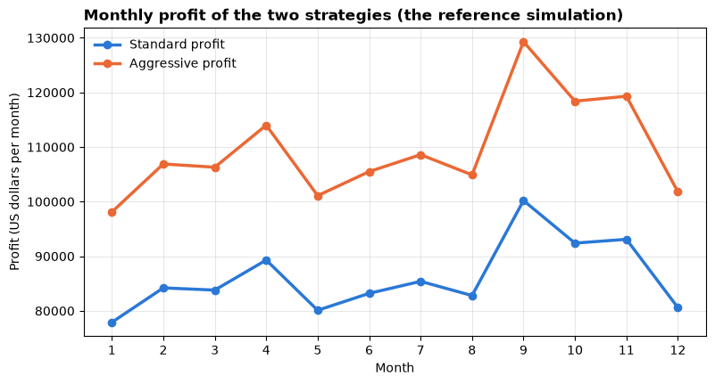

# Assignment 3 — Spreadsheet simulation and decision model

<p class="lead">
Act as the analytics planner for a smart-thermostat launch: simulate twelve months of uncertain demand in Excel for two marketing strategies, freeze the simulation, chart both strategies' monthly profit in Tableau, and write a short executive report that recommends a strategy and explains why simulating uncertainty is safer than planning on a single number.
</p>

*Adapted from the DATA 300 syllabus, Assignment 3 (Spreadsheet simulation and decision model). Brief rewritten for this classroom; the work is done in Microsoft Excel and Tableau, and this notebook adds optional checks.*

> **Graded work: Assignment 3 (6%, CLO 3, 4 and 5)**
>
> - **Set:** Wednesday 18 November (Day 6), after the briefing in the lecture.
> - **Due:** **Sunday 22 November 2026, 23:59 China Standard Time**.
> - **Submit:** two files to the **DATA 300: Assignment 3** drop-box on **GAP (Moodle)**: your locked workbook `YourLastName_DATA300_Assignment3.xlsx` and your report `YourLastName_Assignment3_Report.pdf`.
> - **Work:** individual. Online support is available during the post-class week.

This notebook is the **brief** (read it all first) and a set of **starter checks** you can run on your own workbook. The graded work is the Excel file and the PDF report; you do not submit this notebook.

---

## The scenario

You are an analytics planner at **SmartHome Tech** (a **fictional** company), which is about to launch an AI-powered thermostat. Earlier data mining by your team found two facts that the plan must respect:

1. Baseline demand is about **1,000 units per month**, but market volatility moves it up or down at random by **up to 150 units** in any month.
2. Every thermostat sold earns a fixed profit margin of **100 US dollars**.

Management must choose one of two marketing strategies for the first year:

| Strategy | Marketing cost | Effect on demand |
|---|---|---|
| **A: Standard** | 10,000 US dollars per month (fixed) | Baseline demand plus volatility |
| **B: Aggressive** | 25,000 US dollars per month (fixed) | 1.4 times the Standard demand |

Your simulation runs twelve months under the same random market conditions for both strategies, so that the comparison is fair.

---

## What you must do

| Part | Tool | Task |
|---|---|---|
| 1 | Excel | Build the 12-month simulation, then **lock** the random numbers |
| 2 | Tableau | Chart both strategies' monthly profit as two lines; export the chart as an image |
| 3 | Word | Write a short executive report with the chart, answering two questions |
| 4 | GAP | Submit the locked workbook and the PDF report |

---

## Part 1: The simulation in Excel

Open a **blank** workbook and save it straight away as `YourLastName_DATA300_Assignment3.xlsx`. Work on the first sheet and **do not rename it** (Tableau will show it as *Sheet1*, or 工作表1 in Chinese Excel).

### Step 1: Headers

In row 1, from **A1** to **G1**, type exactly: `Month`, `Baseline_Demand`, `Market_Volatility`, `Standard_Demand`, `Aggressive_Demand`, `Standard_Profit`, `Aggressive_Profit`. The underscores matter: Tableau uses these names as field names.

### Step 2: Formulas

| Column | Rows 2–13 | What it means |
|---|---|---|
| **A** Month | Type 1 to 12 | The month of the first year |
| **B** Baseline_Demand | Type `1000` in every row | The demand the data mining found |
| **C** Market_Volatility | In C2: `=RANDBETWEEN(-150,150)`, then fill down to C13 | A random monthly swing between −150 and +150 units |
| **D** Standard_Demand | In D2: `=B2+C2`, fill down | Units sold with the Standard strategy |
| **E** Aggressive_Demand | In E2: `=ROUND((B2+C2)*1.4,0)`, fill down | 1.4 times the Standard demand, rounded to whole units |
| **F** Standard_Profit | In F2: `=(D2*100)-10000`, fill down | Units × 100 dollars margin − 10,000 dollars marketing |
| **G** Aggressive_Profit | In G2: `=(E2*100)-25000`, fill down | Units × 100 dollars margin − 25,000 dollars marketing |

To fill a formula down, select the cell and double-click the small square at its bottom-right corner (the fill handle), or drag it to row 13. Press **F9** a couple of times and watch columns C to G change: that is the simulation running.

> **Good practice (optional, not required for marks)**
>
> Day 5 taught you to keep inputs out of formulas. You may put the margin, the two marketing costs and the 1.4 multiplier in labelled cells **to the right of the table** (for example in column J) and refer to them with `$` references. Keep columns A to G exactly as named above.

### Step 3: Lock the simulation

`RANDBETWEEN` draws new numbers every time Excel recalculates. Tableau reads the values **saved** in the file, and your report must describe the same twelve months your chart shows, so you must freeze them:

1. Select **A1:G13** and copy (**Ctrl + C**).
2. Without moving the selection, right-click **A1** → **Paste Special → Values** (选择性粘贴 → 数值; the clipboard icon with **123**).
3. Click any cell in column C: the formula bar must now show a **number**, not `=RANDBETWEEN(…)`.
4. Save and close Excel.

---

## Part 2: Decision chart in Tableau

1. Open **Tableau Desktop**. Under **Connect → To a File**, click **Microsoft Excel** and open your workbook.
2. Drag your sheet onto the canvas if it is not there already, then click the **Sheet 1** worksheet tab at the bottom.
3. Drag **Month** to the **Columns** shelf. Right-click the Month pill and choose **Dimension**, so that each month is a separate point instead of one sum.
4. Drag **Measure Values** (at the bottom of the Data pane) to the **Rows** shelf.
5. In the **Measure Values** card that appears below the Marks card, remove every measure except **SUM(Standard Profit)** and **SUM(Aggressive Profit)** (right-click → **Remove**).
6. On the **Marks** card, change the mark type from *Automatic* to **Line**.
7. Drag **Measure Names** onto **Color** in the Marks card, so each strategy has its own coloured line and a legend.
8. Give the sheet a **message title** (double-click the title), label the y-axis with its unit (US dollars per month), and check that the colours are easy to tell apart.
9. **Worksheet → Export → Image…**, save the picture as PNG or JPEG, and insert it into a blank Word document.

---

## Part 3: The executive report

Write a **short executive report** (about one to two pages) for SmartHome Tech's management in the Word document that holds your Tableau chart. Put your name and student ID at the top. Lead with your recommendation, then answer the two questions in connected paragraphs, quoting numbers from **your** locked simulation with units.

| # | Question |
|---|---|
| **1** | **Strategic decision.** Using your Tableau chart, which marketing strategy gives the higher profit, and which gives the more **consistent** profit across the twelve months? In your simulation, was there any month in which the Aggressive strategy earned **less** than the Standard strategy because of its higher fixed cost in a weak month? Explain why this did or did not happen. |
| **2** | **Why simulate?** The model uses a random number generator (`RANDBETWEEN`) to represent the market volatility found by data mining. From a manager's point of view, why is a plan that includes this random risk safer than one that assumes exactly 1,000 units are sold every month? |

> **What a strong report does**
>
> - States the recommendation in the first sentence and quantifies it: total and average monthly profit of each strategy, and the difference, for your twelve months.
> - Judges **consistency** with a number, not only by eye: the range (highest minus lowest month) or the standard deviation (`=STDEV.S(F2:F13)`) of each strategy's monthly profit. Think about whether a larger spread in dollars means a riskier strategy here.
> - Answers "did Aggressive ever lose to Standard?" from the data **and** from the formulas: how weak would a month have to be?
> - Names the limits: one simulated year of 12 months; volatility assumed even between −150 and +150; the 1.4 multiplier and the fixed margin taken as certain.
> - Cites any source you use (APA style), including the course materials.

---

## Part 4: Submit

| Step | What to do | File name |
|---|---|---|
| 1 | Check the workbook is **locked** (column C holds numbers, not formulas) and saved | `YourLastName_DATA300_Assignment3.xlsx` |
| 2 | Save the Word report, with the Tableau chart inside it, as PDF: **File → Save As → PDF** | `YourLastName_Assignment3_Report.pdf` |
| 3 | Log in to **GAP (Moodle)**, open the **DATA 300: Assignment 3** drop-box, upload **both** files and click **Submit** before the deadline | |

Insert the chart into the Word document before saving, so the report is one PDF. If you exported the chart as a PDF instead, combine the files as shown in [Combining PDFs without internet](setup.md#combining-pdfs-without-internet).

---

## How it is marked

The assignment is marked out of 100 with the course's Assignment 3 rubric, then scaled to its 6% weight.

| Criterion | Points | What earns them here |
|---|---|---|
| **CLO 3**: computational problem-solving with data | 25 | A correct, complete simulation: exact headers, working formulas, twelve months, values locked |
| **CLO 4**: predictive models and spreadsheet simulation | 25 | Demand and profit modelled correctly for both strategies; results read correctly from the simulation, with numbers |
| **CLO 5**: evaluating BI tools in a case; managerial reporting with ethical and societal context | 30 | A clear, justified recommendation; consistency judged with evidence; a convincing explanation of why simulating uncertainty protects the organisation and the people who depend on it; limits named |
| **Professional formatting** | 10 | A clean report with the Tableau chart, correct file names, APA-style citations where used |
| **Academic writing** | 10 | Clear, organised paragraphs for managers; correct terms |

Each criterion is judged on a scale from *exemplary* (full points) through *excellent*, *proficient*, *developing* and *unsatisfactory*; a missing submission scores 0.

---

## Starter checks (optional)

The cells below are optional helpers. Run them with **Shift + Enter** in JupyterLab.

### 1. A reference simulation

This cell runs the same model in Python with a **fixed seed**, so you can see what a correct table looks like. Your numbers will be different, because Excel has no seed; only the **structure** and the relationships between columns should match. Do not copy these numbers into your report.


```python
import matplotlib.pyplot as plt
import numpy as np
import pandas as pd
from openpyxl import load_workbook
from pathlib import Path

BLUE, ORANGE = "#2a78d6", "#eb6834"
pd.set_option("display.width", 120)

MARGIN, COST_STANDARD, COST_AGGRESSIVE, MULTIPLIER = 100, 10_000, 25_000, 1.4


def simulate(volatility):
    """The assignment's model for a given list of 12 monthly volatility values."""
    sim = pd.DataFrame({"Month": range(1, 13), "Baseline_Demand": 1000, "Market_Volatility": volatility})
    sim["Standard_Demand"] = sim["Baseline_Demand"] + sim["Market_Volatility"]
    # Excel's ROUND rounds halves away from zero; 1.4 x a whole number never ends in .5, so np.round agrees here
    sim["Aggressive_Demand"] = np.round(sim["Standard_Demand"] * MULTIPLIER).astype(int)
    sim["Standard_Profit"] = sim["Standard_Demand"] * MARGIN - COST_STANDARD
    sim["Aggressive_Profit"] = sim["Aggressive_Demand"] * MARGIN - COST_AGGRESSIVE
    return sim


rng = np.random.default_rng(seed=322)
reference = simulate(rng.integers(-150, 151, 12))      # = RANDBETWEEN(-150, 150)
print("Reference simulation (fixed seed): same structure as your locked sheet")
print(reference.to_string(index=False))
```

    Reference simulation (fixed seed): same structure as your locked sheet
     Month  Baseline_Demand  Market_Volatility  Standard_Demand  Aggressive_Demand  Standard_Profit  Aggressive_Profit
         1             1000               -121              879               1231            77900              98100
         2             1000                -58              942               1319            84200             106900
         3             1000                -62              938               1313            83800             106300
         4             1000                 -7              993               1390            89300             114000
         5             1000                -99              901               1261            80100             101100
         6             1000                -68              932               1305            83200             105500
         7             1000                -46              954               1336            85400             108600
         8             1000                -72              928               1299            82800             104900
         9             1000                102             1102               1543           100200             129300
        10             1000                 24             1024               1434            92400             118400
        11             1000                 31             1031               1443            93100             119300
        12             1000                -94              906               1268            80600             101800


### 2. Check your locked workbook

Save your locked workbook **in the same folder as this notebook**, type your file name in the first line of the next cell, and run it. The check reads your sheet and reports:

- whether the seven headers are exactly right;
- whether any formula is left (the simulation is **not** locked if `RANDBETWEEN` is still there);
- whether every row follows the model's rules (for example D = B + C, and G = E × 100 − 25,000).

If the file is not found, the cell says so and does nothing else.


```python
MY_FILE = "YourLastName_DATA300_Assignment3.xlsx"     # change to your file name

HEADERS = ["Month", "Baseline_Demand", "Market_Volatility", "Standard_Demand",
           "Aggressive_Demand", "Standard_Profit", "Aggressive_Profit"]


def check_workbook(path):
    """Check headers, locking and the model's rules in a student's Assignment 3 workbook."""
    path = Path(path)
    if not path.exists():
        print(f"{path.name} was not found next to this notebook. Save your workbook here and try again.")
        return None
    sheet = load_workbook(path, data_only=False).worksheets[0]
    formulas = [c.coordinate for row in sheet.iter_rows(min_row=1, max_row=13, max_col=7) for c in row
                if isinstance(c.value, str) and c.value.startswith("=")]
    data = pd.read_excel(path, sheet_name=0, usecols="A:G", nrows=12)
    print(f"Sheet checked: {sheet.title}")
    print("Headers:", "OK" if list(data.columns) == HEADERS else f"expected {HEADERS}, found {list(data.columns)}")
    print("Locked: ", "OK, no formulas left" if not formulas else f"NOT locked, formulas in {formulas[:5]}...")
    if list(data.columns) != HEADERS or data.isna().any().any():
        print("Some headers are wrong or some cells are empty: fix them, lock the values in Excel, save, and run this again.")
        return data
    expected = simulate(data["Market_Volatility"].tolist())
    wrong = [col for col in HEADERS if not (data[col] == expected[col]).all()]
    print("Rules:  ", "OK, every row follows the model" if not wrong else f"check the columns {wrong}")
    return data


my_sim = check_workbook(MY_FILE)
```

    YourLastName_DATA300_Assignment3.xlsx was not found next to this notebook. Save your workbook here and try again.


### 3. A quick chart to compare with Tableau

This chart uses your workbook if the check above found it, and the reference simulation otherwise. Your Tableau chart should show the same two lines. Use Tableau's chart, not this one, in your report.


```python
data = my_sim if isinstance(my_sim, pd.DataFrame) and "Standard_Profit" in my_sim else reference
source = "your workbook" if data is not reference else "the reference simulation"

fig, ax = plt.subplots(figsize=(9, 4.5))
ax.plot(data["Month"], data["Standard_Profit"], marker="o", color=BLUE, linewidth=2.5, label="Standard profit")
ax.plot(data["Month"], data["Aggressive_Profit"], marker="o", color=ORANGE, linewidth=2.5, label="Aggressive profit")
ax.set_title(f"Monthly profit of the two strategies ({source})", loc="left", fontweight="bold")
ax.set_xlabel("Month")
ax.set_ylabel("Profit (US dollars per month)")
ax.set_xticks(range(1, 13))
ax.legend(frameon=False)
ax.grid(alpha=0.3)
plt.show()
```


    

    


---

## Final checklist

- [ ] Row 1 has the seven headers exactly; rows 2–13 hold months 1 to 12.
- [ ] The formulas were correct **before** locking (D = B + C; E rounded 1.4 × D; F and G subtract the right marketing cost).
- [ ] The simulation is **locked**: column C holds numbers, not `RANDBETWEEN`.
- [ ] The Tableau chart shows **two lines**, one per strategy, by month, with a legend and a message title.
- [ ] The report leads with a recommendation, answers both questions with numbers from my simulation, and names the limits.
- [ ] Two files uploaded to GAP by **Sunday 22 November, 23:59 China Standard Time**: `YourLastName_DATA300_Assignment3.xlsx` and `YourLastName_Assignment3_Report.pdf`.
