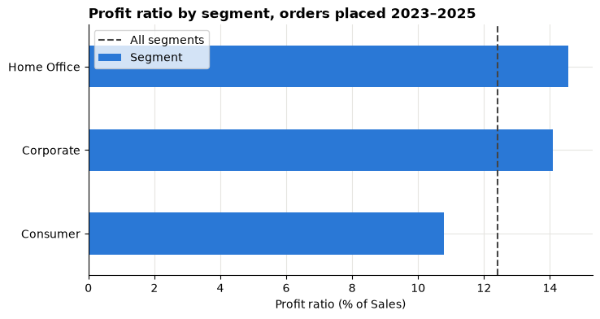
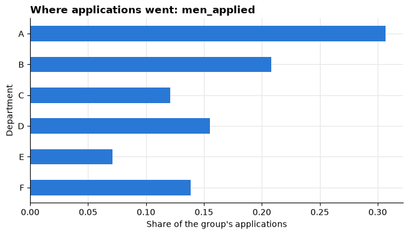

# Session 5 lab: Which segment deserves a closer look?

<p class="lead">
Compare the three customer segments using five measures, calculate each one correctly, check that the numbers add up, write a metric contract, and make a careful recommendation.
</p>

[](https://colab.research.google.com/github/Aayush181509/AnalyticsLecture/blob/main/notebooks/05_metrics_and_kpis_lab.ipynb)

Open this notebook in Google Colab with the button above, then run each cell from top to bottom with **Shift + Enter**. Save your own copy with **File → Save a copy in Drive**.

---

## The business decision

The retail head has one analyst free next month and asks:

> *"Which customer segment should we investigate first, and what should we check before we change any promotions?"*

A big Sales total alone is not enough to decide. A segment can sell a lot and still earn little profit, or have many small orders. In this lab you build a fair comparison.

> **About the data**
>
> The Superstore sample describes a **fictitious** company. Sales and Profit are in **source monetary units**: the currency is not stated, so never add a currency symbol. The source does not explain how Profit is calculated, so we say **profit ratio**, never "margin".
>
> The **Berkeley admissions** counts are the published figures for the six largest departments in 1973 (Bickel, Hammel and O'Connell, 1975, *Science*).

---

## How this lab works

| Part | What you do | Tasks |
|---|---|---|
| **Guided practice** | Follow along step by step, everyone together | G1–G5 |
| **Independent tasks** | Same skills, new questions, on your own or in pairs | I1–I7 |
| **Challenge** | Harder reasoning and debugging | C1–C2 |

Each task has a level:

- **Core**: everyone completes it; it is enough for your portfolio.
- **Stretch**: for when you finish the core tasks early.
- **Challenge**: optional, harder reasoning.

---

## What you will be able to do

1. Define five measures precisely: Sales, Orders, Average order value, Profit and Profit ratio.
2. Calculate them in pandas, for the whole table and for each segment.
3. Calculate ratios **from totals**, not by averaging other ratios.
4. Check that segment results reconcile with the overall total.
5. Explain how a filter changes every measure.
6. Write a metric contract and explain Simpson's paradox with real data.
7. Write a short, evidence-based recommendation with one limitation.

**Evidence you keep:** a segment KPI table, a metric contract, a validation checklist, a Berkeley explanation and a five-sentence recommendation.

Before you start, read the [Session 5 lecture](05_metrics_and_kpis_lecture.md) and have your grain statement from the [Session 2 lab](02_data_and_grain_lab.md) ready.

---

## Guided practice

### G1 (Core): Agree the measures

Every measure uses the **same rows**: all order lines in the table, unless you deliberately apply a filter.

| Measure | What it means | pandas |
|---|---|---|
| **Sales** | Total reported Sales | `df["sales"].sum()` |
| **Orders** | Number of different orders | `df["order_id"].nunique()` |
| **AOV** (average order value) | Sales per order | Sales ÷ Orders |
| **Profit** | Total reported Profit (can be negative) | `df["profit"].sum()` |
| **Profit ratio** | Profit per unit of Sales | Profit ÷ Sales |

> **Totals first, then divide**
>
> AOV and Profit ratio are always calculated from the **totals** of whatever you are looking at. Never average the ratios of individual rows or of segments. You will see why in C1.

> **When there is nothing to divide by**
>
> If a filter leaves no orders or no Sales, the ratio is **not available**. pandas shows this as `NaN` ("not a number"). Read it as *"not available"*, never as 0%.

#### Predict first

Before you run the next cells, write down your answers:

1. Will AOV be larger or smaller than Sales divided by the number of **rows**? Why?
2. Can Profit ratio be negative? When?

Run the setup cell, then load the table.


```python
# Course data setup. Run this cell first; you do not need to understand it yet.
# It downloads the Superstore sample from Tableau's website, checks it is the
# exact version this course was written for, and prepares the order-lines table.
import hashlib
import os
import urllib.request

import matplotlib.pyplot as plt
import pandas as pd

SOURCE_URL = "https://public.tableau.com/app/sample-data/sample_-_superstore.xls"
EXPECTED_SHA256 = "5045ed4fec49cae2cc0dfc5ab0d204ba09efa767fe00c996822499e8cc42fbbd"
SOURCE_FILE = os.environ.get("COURSE_XLS_PATH", "sample_-_superstore.xls")

try:
    import xlrd  # noqa: F401  (needed to read .xls files)
except ImportError:
    import subprocess
    import sys

    subprocess.check_call([sys.executable, "-m", "pip", "install", "-q", "xlrd"])

if not os.path.exists(SOURCE_FILE):
    urllib.request.urlretrieve(SOURCE_URL, SOURCE_FILE)

with open(SOURCE_FILE, "rb") as f:
    digest = hashlib.sha256(f.read()).hexdigest()
if digest != EXPECTED_SHA256:
    print("WARNING: Tableau has changed this sample file since the course was written.")
    print("Your numbers will differ from the lesson. Ask your facilitator for the course copy.")


def load_orders():
    """Return one row per order line, orders placed 2023-01-01 to 2025-12-31."""
    raw = pd.read_excel(SOURCE_FILE, sheet_name="Orders")
    returns = pd.read_excel(SOURCE_FILE, sheet_name="Returns")

    # Orders with more than one Customer ID (a known data issue), found before filtering.
    ids_per_order = raw.groupby("Order ID")["Customer ID"].nunique()
    conflict_orders = set(ids_per_order[ids_per_order > 1].index)

    in_scope = (raw["Order Date"] >= "2023-01-01") & (raw["Order Date"] < "2026-01-01")
    df = raw.loc[in_scope].copy()

    df = df.rename(columns={
        "Row ID": "row_id", "Order ID": "order_id", "Order Date": "order_date",
        "Ship Date": "ship_date", "Ship Mode": "ship_mode", "Customer ID": "customer_id",
        "Segment": "segment", "Country/Region": "country_region", "Region": "region",
        "Category": "category", "Sub-Category": "sub_category", "Product ID": "product_id",
        "Product Name": "product_name", "Sales": "sales", "Quantity": "quantity",
        "Discount": "discount", "Profit": "profit",
    })
    df["returned_order_flag"] = df["order_id"].isin(set(returns["Order ID"])).astype(int)
    df["customer_order_conflict"] = df["order_id"].isin(conflict_orders).astype(int)
    df["customer_analysis_eligible"] = 1 - df["customer_order_conflict"]
    df["order_to_ship_days"] = (df["ship_date"] - df["order_date"]).dt.days
    df["order_month"] = df["order_date"].dt.to_period("M").dt.to_timestamp()

    columns = [
        "row_id", "order_id", "order_date", "ship_date", "ship_mode", "customer_id",
        "segment", "country_region", "region", "category", "sub_category", "product_id",
        "product_name", "sales", "quantity", "discount", "profit", "returned_order_flag",
        "customer_analysis_eligible", "customer_order_conflict", "order_to_ship_days",
        "order_month",
    ]
    return df[columns].sort_values("row_id").reset_index(drop=True)


pd.set_option("display.float_format", "{:,.2f}".format)
plt.rcParams.update({
    "figure.figsize": (8, 4),
    "axes.spines.top": False,
    "axes.spines.right": False,
    "axes.grid": True,
    "axes.axisbelow": True,
    "grid.color": "#e6e5e1",
    "axes.prop_cycle": plt.cycler(color=["#2a78d6", "#eb6834", "#1baf7a"]),
    "axes.titleweight": "bold",
    "axes.titlelocation": "left",
})
print("Setup complete.")
```

    Setup complete.


```python
df = load_orders()
print("Order lines (rows):", len(df))
```

    Order lines (rows): 6815


### G2 (Core): The five measures for the whole table

Read each line: it matches one row of the table in G1.


```python
total_sales = df["sales"].sum()
total_orders = df["order_id"].nunique()
total_profit = df["profit"].sum()

aov = total_sales / total_orders
profit_ratio = total_profit / total_sales

print("Sales:           ", round(total_sales, 2))
print("Orders:          ", total_orders)
print("AOV:             ", round(aov, 2))
print("Profit:          ", round(total_profit, 2))
print("Profit ratio (%):", round(profit_ratio * 100, 1))
```

    Sales:            1580966.82
    Orders:           3388
    AOV:              466.64
    Profit:           196370.47
    Profit ratio (%): 12.4


`round(x, 2)` keeps two decimal places, just for display. We multiply the profit ratio by 100 to show it as a percentage.

> **Check your predictions**
>
> Compare the number of rows with the number of orders above. Does that change your answer to prediction 1?

---

### G3 (Core): The segment KPI table

#### Step 1: totals for each segment

In the Session 1 lab you used `groupby` with one sum. `.agg` lets you calculate several totals at once. Each line inside reads as **new column name = (column to use, how to summarise it)**.


```python
segment_kpis = df.groupby("segment").agg(
    sales=("sales", "sum"),
    orders=("order_id", "nunique"),
    profit=("profit", "sum"),
)
segment_kpis
```


<div>
<style scoped>
    .dataframe tbody tr th:only-of-type {
        vertical-align: middle;
    }

    .dataframe tbody tr th {
        vertical-align: top;
    }

    .dataframe thead th {
        text-align: right;
    }
</style>
<table border="1" class="dataframe">
  <thead>
    <tr style="text-align: right;">
      <th></th>
      <th>sales</th>
      <th>orders</th>
      <th>profit</th>
    </tr>
    <tr>
      <th>segment</th>
      <th></th>
      <th></th>
      <th></th>
    </tr>
  </thead>
  <tbody>
    <tr>
      <th>Consumer</th>
      <td>835,747.86</td>
      <td>1738</td>
      <td>90,101.17</td>
    </tr>
    <tr>
      <th>Corporate</th>
      <td>467,562.02</td>
      <td>1044</td>
      <td>65,842.38</td>
    </tr>
    <tr>
      <th>Home Office</th>
      <td>277,656.95</td>
      <td>606</td>
      <td>40,426.92</td>
    </tr>
  </tbody>
</table>
</div>


#### Step 2: the two ratios, from each segment's totals


```python
segment_kpis["aov"] = segment_kpis["sales"] / segment_kpis["orders"]
segment_kpis["profit_ratio_pct"] = segment_kpis["profit"] / segment_kpis["sales"] * 100
segment_kpis
```


<div>
<style scoped>
    .dataframe tbody tr th:only-of-type {
        vertical-align: middle;
    }

    .dataframe tbody tr th {
        vertical-align: top;
    }

    .dataframe thead th {
        text-align: right;
    }
</style>
<table border="1" class="dataframe">
  <thead>
    <tr style="text-align: right;">
      <th></th>
      <th>sales</th>
      <th>orders</th>
      <th>profit</th>
      <th>aov</th>
      <th>profit_ratio_pct</th>
    </tr>
    <tr>
      <th>segment</th>
      <th></th>
      <th></th>
      <th></th>
      <th></th>
      <th></th>
    </tr>
  </thead>
  <tbody>
    <tr>
      <th>Consumer</th>
      <td>835,747.86</td>
      <td>1738</td>
      <td>90,101.17</td>
      <td>480.87</td>
      <td>10.78</td>
    </tr>
    <tr>
      <th>Corporate</th>
      <td>467,562.02</td>
      <td>1044</td>
      <td>65,842.38</td>
      <td>447.86</td>
      <td>14.08</td>
    </tr>
    <tr>
      <th>Home Office</th>
      <td>277,656.95</td>
      <td>606</td>
      <td>40,426.92</td>
      <td>458.18</td>
      <td>14.56</td>
    </tr>
  </tbody>
</table>
</div>


#### Step 3: add an overall row

The overall row uses the totals from G2. Its AOV and profit ratio are **recalculated from totals**, not added up or averaged from the rows above.


```python
segment_kpis.loc["All"] = [total_sales, total_orders, total_profit, aov, profit_ratio * 100]
segment_kpis["orders"] = segment_kpis["orders"].astype(int)
segment_kpis = segment_kpis[["sales", "orders", "aov", "profit", "profit_ratio_pct"]]
segment_kpis.round(2)
```


<div>
<style scoped>
    .dataframe tbody tr th:only-of-type {
        vertical-align: middle;
    }

    .dataframe tbody tr th {
        vertical-align: top;
    }

    .dataframe thead th {
        text-align: right;
    }
</style>
<table border="1" class="dataframe">
  <thead>
    <tr style="text-align: right;">
      <th></th>
      <th>sales</th>
      <th>orders</th>
      <th>aov</th>
      <th>profit</th>
      <th>profit_ratio_pct</th>
    </tr>
    <tr>
      <th>segment</th>
      <th></th>
      <th></th>
      <th></th>
      <th></th>
      <th></th>
    </tr>
  </thead>
  <tbody>
    <tr>
      <th>Consumer</th>
      <td>835,747.86</td>
      <td>1738</td>
      <td>480.87</td>
      <td>90,101.17</td>
      <td>10.78</td>
    </tr>
    <tr>
      <th>Corporate</th>
      <td>467,562.02</td>
      <td>1044</td>
      <td>447.86</td>
      <td>65,842.38</td>
      <td>14.08</td>
    </tr>
    <tr>
      <th>Home Office</th>
      <td>277,656.95</td>
      <td>606</td>
      <td>458.18</td>
      <td>40,426.92</td>
      <td>14.56</td>
    </tr>
    <tr>
      <th>All</th>
      <td>1,580,966.82</td>
      <td>3388</td>
      <td>466.64</td>
      <td>196,370.47</td>
      <td>12.42</td>
    </tr>
  </tbody>
</table>
</div>


The second line keeps `orders` as whole numbers. The third line puts the columns in the same order as the table in G1.

Give the table a clear title in your evidence log, for example *"Segment comparison, orders placed 2023–2025 (source monetary units)"*.

#### A picture of the profit ratio

The dashed line is the overall profit ratio from the **All** row.


```python
by_segment = segment_kpis.drop("All")

by_segment["profit_ratio_pct"].sort_values().plot(
    kind="barh", title="Profit ratio by segment, orders placed 2023–2025", label="Segment"
)
plt.axvline(profit_ratio * 100, color="#444444", linestyle="--", label="All segments")
plt.xlabel("Profit ratio (% of Sales)")
plt.ylabel("")
plt.legend()
plt.show()
```


    

    


> **Read the chart**
>
> Which segment is above the line and which is below? Now look back at the Sales column. Is the segment with the most Sales also the one with the highest profit ratio?

---

### G4 (Core): Check that it reconciles

A table you cannot reconcile is a table you cannot trust. `by_segment` is the table without the **All** row.


```python
print("Sales:  segments add up to", round(by_segment["sales"].sum(), 2), "| overall", round(total_sales, 2))
print("Profit: segments add up to", round(by_segment["profit"].sum(), 2), "| overall", round(total_profit, 2))
print("Orders: segments add up to", by_segment["orders"].sum(), "| overall", total_orders)
```

    Sales:  segments add up to 1580966.82 | overall 1580966.82
    Profit: segments add up to 196370.47 | overall 196370.47
    Orders: segments add up to 3388 | overall 3388


Orders can only add up if every order belongs to **exactly one** segment. Check it: count the different segments inside each order and look at the largest count.


```python
segments_per_order = df.groupby("order_id")["segment"].nunique()
print("Largest number of segments in one order:", segments_per_order.max())
```

    Largest number of segments in one order: 1


Tick each check in your evidence log:

- [ ] The segment **Sales** add up to the overall total.
- [ ] The segment **Profit** values add up to the overall total.
- [ ] The segment **Orders** add up to the overall total, because each order sits in one segment.
- [ ] The overall **AOV** is total Sales ÷ total Orders, **not** the average of the segment AOVs.
- [ ] The overall **profit ratio** is total Profit ÷ total Sales, **not** the average of the segment ratios.

> **If a total looks wrong**
>
> Check that every measure used the same rows (the same filters), and that the **All** row was recalculated from totals rather than added up.

---

### G5 (Core): Package the steps as a function

Building the table step by step takes several cells. To repeat it quickly on filtered data, we package the same steps as a **function**: a named recipe you can reuse. You do not need to write functions yet; just read it and see that each line matches a step above.


```python
def kpi_table(data, by):
    """Five measures for each group in the column `by`, plus an 'All' row from totals."""
    table = data.groupby(by).agg(
        sales=("sales", "sum"),
        orders=("order_id", "nunique"),
        profit=("profit", "sum"),
    )
    table.loc["All"] = [data["sales"].sum(), data["order_id"].nunique(), data["profit"].sum()]
    table["orders"] = table["orders"].astype(int)
    table["aov"] = table["sales"] / table["orders"].replace(0, float("nan"))
    table["profit_ratio_pct"] = table["profit"] / table["sales"].replace(0, float("nan")) * 100
    return table[["sales", "orders", "aov", "profit", "profit_ratio_pct"]].round(2)


kpi_table(df, "segment")
```


<div>
<style scoped>
    .dataframe tbody tr th:only-of-type {
        vertical-align: middle;
    }

    .dataframe tbody tr th {
        vertical-align: top;
    }

    .dataframe thead th {
        text-align: right;
    }
</style>
<table border="1" class="dataframe">
  <thead>
    <tr style="text-align: right;">
      <th></th>
      <th>sales</th>
      <th>orders</th>
      <th>aov</th>
      <th>profit</th>
      <th>profit_ratio_pct</th>
    </tr>
    <tr>
      <th>segment</th>
      <th></th>
      <th></th>
      <th></th>
      <th></th>
      <th></th>
    </tr>
  </thead>
  <tbody>
    <tr>
      <th>Consumer</th>
      <td>835,747.86</td>
      <td>1738</td>
      <td>480.87</td>
      <td>90,101.17</td>
      <td>10.78</td>
    </tr>
    <tr>
      <th>Corporate</th>
      <td>467,562.02</td>
      <td>1044</td>
      <td>447.86</td>
      <td>65,842.38</td>
      <td>14.08</td>
    </tr>
    <tr>
      <th>Home Office</th>
      <td>277,656.95</td>
      <td>606</td>
      <td>458.18</td>
      <td>40,426.92</td>
      <td>14.56</td>
    </tr>
    <tr>
      <th>All</th>
      <td>1,580,966.82</td>
      <td>3388</td>
      <td>466.64</td>
      <td>196,370.47</td>
      <td>12.42</td>
    </tr>
  </tbody>
</table>
</div>


It gives the same table as G3. The `.replace(0, float("nan"))` parts make a zero denominator show `NaN` (*not available*) instead of a misleading number.

---

## Independent tasks

### I1 (Core): Filter by region

1. Run the cell below for the West region.
2. Change `"West"` to `"East"`, `"Central"` or `"South"` and run it again.
3. Record all five measures for each segment in your chosen region.
4. Write two sentences: does the ranking of segments by profit ratio change inside this region?

> **Your turn:** change the code in the next cell and run it again.


```python
selected = df[df["region"] == "West"]
kpi_table(selected, "segment")
```


<div>
<style scoped>
    .dataframe tbody tr th:only-of-type {
        vertical-align: middle;
    }

    .dataframe tbody tr th {
        vertical-align: top;
    }

    .dataframe thead th {
        text-align: right;
    }
</style>
<table border="1" class="dataframe">
  <thead>
    <tr style="text-align: right;">
      <th></th>
      <th>sales</th>
      <th>orders</th>
      <th>aov</th>
      <th>profit</th>
      <th>profit_ratio_pct</th>
    </tr>
    <tr>
      <th>segment</th>
      <th></th>
      <th></th>
      <th></th>
      <th></th>
      <th></th>
    </tr>
  </thead>
  <tbody>
    <tr>
      <th>Consumer</th>
      <td>256,522.36</td>
      <td>562</td>
      <td>456.45</td>
      <td>36,016.12</td>
      <td>14.04</td>
    </tr>
    <tr>
      <th>Corporate</th>
      <td>140,280.49</td>
      <td>324</td>
      <td>432.96</td>
      <td>18,655.27</td>
      <td>13.30</td>
    </tr>
    <tr>
      <th>Home Office</th>
      <td>84,769.72</td>
      <td>203</td>
      <td>417.58</td>
      <td>10,702.62</td>
      <td>12.63</td>
    </tr>
    <tr>
      <th>All</th>
      <td>481,572.58</td>
      <td>1089</td>
      <td>442.22</td>
      <td>65,374.01</td>
      <td>13.58</td>
    </tr>
  </tbody>
</table>
</div>


> **A filter changes every measure**
>
> The filter removes rows **before** anything is added up. So Sales, Orders, Profit and both ratios all describe the filtered rows only, including the **All** row.

---

### I2 (Core): Write a metric contract

A metric contract removes every choice an analyst could make differently (see Part 2 of the lecture). The cell below holds a contract for **Profit ratio** with three fields left for you to complete.

1. Replace each `"???"` with your own wording.
2. Run the cell to see the contract as a table.
3. Run the next cell: it calculates the measure **only from the contract's choices** and compares it with your KPI table. They must match.

> **Your turn:** change the code in the next cell and run it again.


```python
profit_ratio_contract = {
    "name": "Profit ratio",
    "purpose": "Compare how much profit each segment keeps per unit of Sales",
    "grain": "One order line",
    "numerator": "Sum of profit",
    "denominator": "???",
    "scope": "???",
    "zero_rule": "???",
    "unit": "Percent of Sales, 1 decimal",
    "owner": "Retail analytics lead",
}
pd.Series(profit_ratio_contract, name="definition").to_frame()
```


<div>
<style scoped>
    .dataframe tbody tr th:only-of-type {
        vertical-align: middle;
    }

    .dataframe tbody tr th {
        vertical-align: top;
    }

    .dataframe thead th {
        text-align: right;
    }
</style>
<table border="1" class="dataframe">
  <thead>
    <tr style="text-align: right;">
      <th></th>
      <th>definition</th>
    </tr>
  </thead>
  <tbody>
    <tr>
      <th>name</th>
      <td>Profit ratio</td>
    </tr>
    <tr>
      <th>purpose</th>
      <td>Compare how much profit each segment keeps per...</td>
    </tr>
    <tr>
      <th>grain</th>
      <td>One order line</td>
    </tr>
    <tr>
      <th>numerator</th>
      <td>Sum of profit</td>
    </tr>
    <tr>
      <th>denominator</th>
      <td>???</td>
    </tr>
    <tr>
      <th>scope</th>
      <td>???</td>
    </tr>
    <tr>
      <th>zero_rule</th>
      <td>???</td>
    </tr>
    <tr>
      <th>unit</th>
      <td>Percent of Sales, 1 decimal</td>
    </tr>
    <tr>
      <th>owner</th>
      <td>Retail analytics lead</td>
    </tr>
  </tbody>
</table>
</div>


```python
# Calculate the profit ratio for each segment exactly as the contract says, then compare.
from_contract = df.groupby("segment")["profit"].sum() / df.groupby("segment")["sales"].sum() * 100
comparison = pd.DataFrame({
    "from contract": from_contract.round(2),
    "from KPI table": by_segment["profit_ratio_pct"].round(2),
})
comparison["match"] = (comparison["from contract"] - comparison["from KPI table"]).abs() < 0.01
comparison
```


<div>
<style scoped>
    .dataframe tbody tr th:only-of-type {
        vertical-align: middle;
    }

    .dataframe tbody tr th {
        vertical-align: top;
    }

    .dataframe thead th {
        text-align: right;
    }
</style>
<table border="1" class="dataframe">
  <thead>
    <tr style="text-align: right;">
      <th></th>
      <th>from contract</th>
      <th>from KPI table</th>
      <th>match</th>
    </tr>
    <tr>
      <th>segment</th>
      <th></th>
      <th></th>
      <th></th>
    </tr>
  </thead>
  <tbody>
    <tr>
      <th>Consumer</th>
      <td>10.78</td>
      <td>10.78</td>
      <td>True</td>
    </tr>
    <tr>
      <th>Corporate</th>
      <td>14.08</td>
      <td>14.08</td>
      <td>True</td>
    </tr>
    <tr>
      <th>Home Office</th>
      <td>14.56</td>
      <td>14.56</td>
      <td>True</td>
    </tr>
  </tbody>
</table>
</div>


4. Now write a second contract, for **Orders** or **AOV**, in your evidence log. Pay special attention to the denominator and to what happens when a filter leaves no rows.

> **A contract is a promise**
>
> If anyone reports "profit ratio" with a different denominator or scope, the contract shows the difference immediately. That is the point: disagreements become visible instead of hidden in code.

---

### I3 (Core): Berkeley admissions and Simpson's paradox

The six largest departments at UC Berkeley in 1973, with the number of applicants and the number admitted.

1. Run the first cell to calculate the admission rate of men and women in each department.
2. Run the second cell to calculate the combined rate for the six departments.
3. Write two sentences: in how many departments is the women's rate higher, and which group has the higher combined rate?


```python
berkeley = pd.DataFrame({
    "department": ["A", "B", "C", "D", "E", "F"],
    "men_applied":     [825, 560, 325, 417, 191, 373],
    "men_admitted":    [512, 353, 120, 138,  53,  22],
    "women_applied":   [108,  25, 593, 375, 393, 341],
    "women_admitted":  [ 89,  17, 202, 131,  94,  24],
}).set_index("department")

berkeley["men_rate"] = berkeley["men_admitted"] / berkeley["men_applied"]
berkeley["women_rate"] = berkeley["women_admitted"] / berkeley["women_applied"]
berkeley[["men_rate", "women_rate"]].round(3)
```


<div>
<style scoped>
    .dataframe tbody tr th:only-of-type {
        vertical-align: middle;
    }

    .dataframe tbody tr th {
        vertical-align: top;
    }

    .dataframe thead th {
        text-align: right;
    }
</style>
<table border="1" class="dataframe">
  <thead>
    <tr style="text-align: right;">
      <th></th>
      <th>men_rate</th>
      <th>women_rate</th>
    </tr>
    <tr>
      <th>department</th>
      <th></th>
      <th></th>
    </tr>
  </thead>
  <tbody>
    <tr>
      <th>A</th>
      <td>0.62</td>
      <td>0.82</td>
    </tr>
    <tr>
      <th>B</th>
      <td>0.63</td>
      <td>0.68</td>
    </tr>
    <tr>
      <th>C</th>
      <td>0.37</td>
      <td>0.34</td>
    </tr>
    <tr>
      <th>D</th>
      <td>0.33</td>
      <td>0.35</td>
    </tr>
    <tr>
      <th>E</th>
      <td>0.28</td>
      <td>0.24</td>
    </tr>
    <tr>
      <th>F</th>
      <td>0.06</td>
      <td>0.07</td>
    </tr>
  </tbody>
</table>
</div>


```python
men_overall = berkeley["men_admitted"].sum() / berkeley["men_applied"].sum()
women_overall = berkeley["women_admitted"].sum() / berkeley["women_applied"].sum()
print("Six departments combined, men:  ", f"{men_overall:.1%}")
print("Six departments combined, women:", f"{women_overall:.1%}")
print("Departments where women's rate is higher:", (berkeley["women_rate"] > berkeley["men_rate"]).sum())
```

    Six departments combined, men:   44.5%
    Six departments combined, women: 30.4%
    Departments where women's rate is higher: 4


4. Now find the reason. The cell below shows where each group applied. Change `"men_applied"` to `"women_applied"` and compare the two.
5. Explain the reversal in three sentences for a non-technical reader. Use the words *mix* and *weighted*.

> **Your turn:** change the code in the next cell and run it again.


```python
# Share of the group's applications that went to each department.
# Change "men_applied" to "women_applied" and run again.
group = "men_applied"
share = berkeley[group] / berkeley[group].sum()
# Departments stay in the same order (A at the top) so the two charts are easy to compare.
share.sort_index(ascending=False).plot(kind="barh", title=f"Where applications went: {group}")
plt.xlabel("Share of the group's applications")
plt.ylabel("Department")
plt.show()
```


    

    


> **Careful wording**
>
> The department view shows that the combined gap is explained by **where** people applied. It does not, by itself, prove there was no bias: why the groups applied to different departments is a separate question.

---

### I4 (Core): Make a recommendation

Write **five sentences** to the retail head:

1. **Recommendation:** which segment to investigate first.
2. **Evidence 1:** one measure, with its value from your table and how it compares with the **All** row.
3. **Evidence 2:** a second, different measure.
4. **Limitation:** one thing this data cannot tell you. For example, it shows which segment *looks* different; it does not show *why*.
5. **Next check:** one specific piece of evidence to request before changing promotions.

Copy the numbers from **the outputs above**; do not retype them from memory.

> **Association, not cause**
>
> If a segment with more discounts has a lower profit ratio, that is a pattern worth investigating. It is not proof that the discounts caused it. Other differences between segments, such as product mix, could explain it.

---

### I5 (Stretch): Look inside one category

1. Run the cell below, which keeps only Furniture lines.
2. Change `"Furniture"` to `"Office Supplies"` or `"Technology"`.
3. Here AOV no longer means full basket value. It means *"Sales of this category's lines per order that contains this category"*. Change the second `"aov"` in the `rename` line to a name that says so, for example `"category_sales_per_order"`.

> **Your turn:** change the code in the next cell and run it again.


```python
selected = df[df["category"] == "Furniture"]
category_view = kpi_table(selected, "segment")
category_view = category_view.rename(columns={"aov": "aov"})
category_view
```


<div>
<style scoped>
    .dataframe tbody tr th:only-of-type {
        vertical-align: middle;
    }

    .dataframe tbody tr th {
        vertical-align: top;
    }

    .dataframe thead th {
        text-align: right;
    }
</style>
<table border="1" class="dataframe">
  <thead>
    <tr style="text-align: right;">
      <th></th>
      <th>sales</th>
      <th>orders</th>
      <th>aov</th>
      <th>profit</th>
      <th>profit_ratio_pct</th>
    </tr>
    <tr>
      <th>segment</th>
      <th></th>
      <th></th>
      <th></th>
      <th></th>
      <th></th>
    </tr>
  </thead>
  <tbody>
    <tr>
      <th>Consumer</th>
      <td>283,170.14</td>
      <td>635</td>
      <td>445.94</td>
      <td>5,364.12</td>
      <td>1.89</td>
    </tr>
    <tr>
      <th>Corporate</th>
      <td>169,851.05</td>
      <td>394</td>
      <td>431.09</td>
      <td>6,636.46</td>
      <td>3.91</td>
    </tr>
    <tr>
      <th>Home Office</th>
      <td>82,413.65</td>
      <td>206</td>
      <td>400.07</td>
      <td>4,380.18</td>
      <td>5.31</td>
    </tr>
    <tr>
      <th>All</th>
      <td>535,434.83</td>
      <td>1235</td>
      <td>433.55</td>
      <td>16,380.76</td>
      <td>3.06</td>
    </tr>
  </tbody>
</table>
</div>


---

### I6 (Stretch): Do category orders add up?

Now group by **category** instead of segment, with no filter.

1. Run the cell and compare the two printed numbers.
2. In one sentence, explain why they are different. *Think about an order that contains both a chair and some paper.*

> **Your turn:** change the code in the next cell and run it again.


```python
by_category = kpi_table(df, "category")
print("Category orders added up:", by_category.drop("All")["orders"].sum())
print("Overall orders:          ", by_category.loc["All", "orders"])
by_category
```

    Category orders added up: 4779
    Overall orders:           3388


<div>
<style scoped>
    .dataframe tbody tr th:only-of-type {
        vertical-align: middle;
    }

    .dataframe tbody tr th {
        vertical-align: top;
    }

    .dataframe thead th {
        text-align: right;
    }
</style>
<table border="1" class="dataframe">
  <thead>
    <tr style="text-align: right;">
      <th></th>
      <th>sales</th>
      <th>orders</th>
      <th>aov</th>
      <th>profit</th>
      <th>profit_ratio_pct</th>
    </tr>
    <tr>
      <th>category</th>
      <th></th>
      <th></th>
      <th></th>
      <th></th>
      <th></th>
    </tr>
  </thead>
  <tbody>
    <tr>
      <th>Furniture</th>
      <td>535,434.83</td>
      <td>1235</td>
      <td>433.55</td>
      <td>16,380.76</td>
      <td>3.06</td>
    </tr>
    <tr>
      <th>Office Supplies</th>
      <td>478,057.88</td>
      <td>2516</td>
      <td>190.01</td>
      <td>84,280.42</td>
      <td>17.63</td>
    </tr>
    <tr>
      <th>Technology</th>
      <td>567,474.11</td>
      <td>1028</td>
      <td>552.02</td>
      <td>95,709.29</td>
      <td>16.87</td>
    </tr>
    <tr>
      <th>All</th>
      <td>1,580,966.82</td>
      <td>3388</td>
      <td>466.64</td>
      <td>196,370.47</td>
      <td>12.42</td>
    </tr>
  </tbody>
</table>
</div>


---

### I7 (Stretch): Does the segment ranking hold inside every category?

Simpson's paradox can hide in any table. Check whether the ranking of segments by profit ratio is the same inside each category as it is overall.

1. Run the cell. Each row is a category; each column a segment.
2. Compare each row's order with the overall ranking from G3.
3. Change `"category"` to `"region"` and check again. Write one sentence on what you find.

> **Your turn:** change the code in the next cell and run it again.


```python
by = "category"
inside = df.groupby([by, "segment"])[["profit", "sales"]].sum()
inside = (inside["profit"] / inside["sales"] * 100).unstack().round(1)
inside["highest segment"] = inside.idxmax(axis=1)
inside
```


<div>
<style scoped>
    .dataframe tbody tr th:only-of-type {
        vertical-align: middle;
    }

    .dataframe tbody tr th {
        vertical-align: top;
    }

    .dataframe thead th {
        text-align: right;
    }
</style>
<table border="1" class="dataframe">
  <thead>
    <tr style="text-align: right;">
      <th>segment</th>
      <th>Consumer</th>
      <th>Corporate</th>
      <th>Home Office</th>
      <th>highest segment</th>
    </tr>
    <tr>
      <th>category</th>
      <th></th>
      <th></th>
      <th></th>
      <th></th>
    </tr>
  </thead>
  <tbody>
    <tr>
      <th>Furniture</th>
      <td>1.90</td>
      <td>3.90</td>
      <td>5.30</td>
      <td>Home Office</td>
    </tr>
    <tr>
      <th>Office Supplies</th>
      <td>15.70</td>
      <td>17.60</td>
      <td>23.50</td>
      <td>Home Office</td>
    </tr>
    <tr>
      <th>Technology</th>
      <td>15.10</td>
      <td>21.80</td>
      <td>14.60</td>
      <td>Corporate</td>
    </tr>
  </tbody>
</table>
</div>


---

## Challenge

### C1 (Challenge): Debug a colleague's KPI summary

A colleague sends you this summary:

> *"Our overall profit ratio is the average of the three segment ratios. And our average order value is total Sales divided by the number of rows."*

Their code is below.

1. Run it to calculate the colleague's two numbers.
2. Compare them with the **All** row of your segment table in G3.
3. Explain each mistake in one sentence.
4. Which segment has the most influence on the correct overall profit ratio, and why? Add a line `print(by_segment["sales"] / total_sales * 100)` to see each segment's share of Sales.

> **Your turn:** change the code in the next cell and run it again.


```python
colleague_ratio = by_segment["profit_ratio_pct"].mean()
colleague_aov = df["sales"].sum() / len(df)

print("Colleague's overall profit ratio (%):", round(colleague_ratio, 1))
print("Colleague's AOV:                     ", round(colleague_aov, 2))
```

    Colleague's overall profit ratio (%): 13.1
    Colleague's AOV:                      231.98


> **Think about weights**
>
> A segment with much more Sales should pull the overall ratio more strongly than a small segment. Does a simple average of the three ratios allow that? And what does one **row** represent: an order, or one product line within an order?

> **How would you check your fix?**
>
> Multiply each segment's profit ratio by its share of Sales and add the three results. You should get the **All** row's ratio exactly.

### C2 (Challenge): Make the colleague's numbers look right, honestly

Your colleague now asks: *"So when is the average of the segment ratios ever correct?"*

1. In the cell below, change the three `sales` values so that the simple mean of the ratios equals the ratio of the sums. Keep the profit ratios the same (change `profit` in proportion).
2. Write one sentence stating the general rule.

> **Your turn:** change the code in the next cell and run it again.


```python
toy = pd.DataFrame({
    "sales":  [600, 300, 100],
    "profit": [ 60,  45,  20],
}, index=["Consumer", "Corporate", "Home Office"])
toy["ratio"] = toy["profit"] / toy["sales"]
print("Simple mean of ratios:", f"{toy['ratio'].mean():.2%}")
print("Ratio of sums:        ", f"{toy['profit'].sum() / toy['sales'].sum():.2%}")
toy
```

    Simple mean of ratios: 15.00%
    Ratio of sums:         12.50%


<div>
<style scoped>
    .dataframe tbody tr th:only-of-type {
        vertical-align: middle;
    }

    .dataframe tbody tr th {
        vertical-align: top;
    }

    .dataframe thead th {
        text-align: right;
    }
</style>
<table border="1" class="dataframe">
  <thead>
    <tr style="text-align: right;">
      <th></th>
      <th>sales</th>
      <th>profit</th>
      <th>ratio</th>
    </tr>
  </thead>
  <tbody>
    <tr>
      <th>Consumer</th>
      <td>600</td>
      <td>60</td>
      <td>0.10</td>
    </tr>
    <tr>
      <th>Corporate</th>
      <td>300</td>
      <td>45</td>
      <td>0.15</td>
    </tr>
    <tr>
      <th>Home Office</th>
      <td>100</td>
      <td>20</td>
      <td>0.20</td>
    </tr>
  </tbody>
</table>
</div>


---

## Validation checklist

Before submitting, confirm:

- [ ] Every measure uses the same filters and date scope.
- [ ] Orders are counted with `nunique`, not as rows.
- [ ] AOV and Profit ratio are calculated from totals.
- [ ] Segment Sales, Profit and Orders reconcile with the **All** row.
- [ ] Money is labelled "source monetary units", with no currency symbol.
- [ ] A `NaN` ratio is described as "not available", not 0%.
- [ ] Your metric contract states the denominator, scope and zero rule.
- [ ] The recommendation names a limitation and a next check.

---

## Exit ticket

1. Why is the average of three segment ratios not the overall ratio?
2. What does a `NaN` AOV or profit ratio mean?
3. In one sentence, why did the combined Berkeley comparison point the other way from most departments?
4. One question you would want answered before acting on your recommendation.

---

## Evidence to keep

- [ ] Segment KPI table with an **All** row and a clear title (G3)
- [ ] Reconciliation checks ticked (G4)
- [ ] One region's KPI table with two sentences (I1)
- [ ] Two metric contracts: Profit ratio and one more (I2)
- [ ] Berkeley explanation in three sentences (I3)
- [ ] Five-sentence recommendation (I4)
- [ ] Corrected colleague summary (C1, if attempted)

---

## After the lab

- Finish any region and category work from I1, I5 and I6.
- Next: the [Session 6 lecture](06_visualisation_principles_lecture.md), on choosing and designing honest charts.
